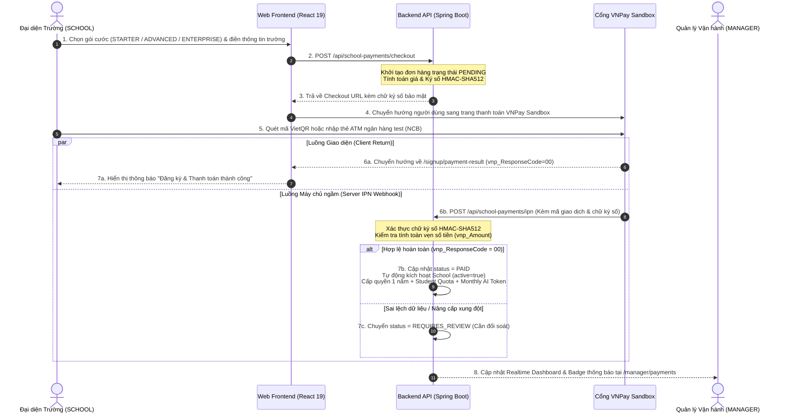

# CẨM NANG NGHIỆP VỤ B2B PAYMENT & AI TOKEN QUOTA MANAGEMENT

> **Dự án:** PhysLive – Interactive Physics Simulation Platform for High School Teachers  
> **Tác giả tài liệu:** Dành riêng cho Master Nguyễn Thế Hùng (`HungNT` - SE183807)  
> **Vai trò phụ trách:** `ADMIN` (Super Admin) & `MANAGER` (Vận hành Nền tảng B2B)  
> **Phạm vi mã nguồn:** [`F:\Fcak\Code\PhysLive`](file:///F:/Fcak/Code/PhysLive)  
> **Mục tiêu:** Ôn tập chuyên sâu phục vụ bảo vệ đồ án Capstone Review 2 (05/11/2026)  

---

## 1. TỔNG QUAN LUỒNG THANH TOÁN B2B (GIỮA ROLE `SCHOOL` VÀ `MANAGER`)

Trong hệ sinh thái **PhysLive**, mô hình kinh doanh là **B2B SaaS (Business-to-Business Software-as-a-Service)**: Nền tảng không bán lẻ cho từng học sinh mà ký hợp đồng cấp bản quyền theo năm cho các trường THPT đối tác (`SCHOOL`).

### 1.1. Sơ đồ Luồng Nghiệp vụ Thanh toán B2B



---

## 2. VNPAY SANDBOX LÀ GÌ & CÁCH HOẠT ĐỘNG TRÊN DỰ ÁN

### 2.1. Khái niệm "Sandbox" (Môi trường Hộp cát Ảo)
* **Sandbox là gì?**  
  Là môi trường máy chủ thử nghiệm do cổng thanh toán VNPay (hoặc PayOS) cung cấp độc lập cho các lập trình viên. 
* **Bản chất dòng tiền:**  
  Tiền giao dịch trong Sandbox là **tiền ảo (không bị trừ tiền thật trong tài khoản cá nhân)**. Tuy nhiên, toàn bộ quy trình công nghệ gồm: sinh mã giao dịch, thuật toán băm mã hóa bảo mật, mã phản hồi ngân hàng và luồng Webhook ngầm hoạt động **chính xác 100% như hệ thống thật của ngân hàng**.

### 2.2. Cách triển khai cụ thể trong mã nguồn PhysLive
Toàn bộ mã nguồn thanh toán được triển khai tại:  
👉 [`SchoolPaymentService.java`](file:///F:/Fcak/Code/PhysLive/backend/src/main/java/com/example/backend/system/school/service/SchoolPaymentService.java)

1. **Đóng gói tham số theo chuẩn VNPay v2.1.0:**
   * `vnp_Version`: `2.1.0`
   * `vnp_Command`: `pay`
   * `vnp_TmnCode`: Mã định danh Merchant cấp cho PhysLive.
   * `vnp_Amount`: Số tiền nhân 100 (Ví dụ gói STARTER `30,000,000 VNĐ` ➔ truyền đi `3000000000` vì VNPay không dùng số thập phân).
   * `vnp_TxnRef`: Mã tham chiếu giao dịch độc nhất (UUID ngẫu nhiên chống trùng lặp đơn).
   * `vnp_OrderInfo`: Nội dung chuyển khoản (Ví dụ: `PhysLiveSTARTER`).
   * `vnp_ReturnUrl`: Địa chỉ web trình duyệt quay về sau khi thanh toán xong.
   * `vnp_ExpireDate`: Khống chế thời gian hết hạn của phiên thanh toán (15 phút).
2. **Ký số bảo mật chuẩn HMAC-SHA512:**
   * Trước khi gửi URL sang VNPay, backend gom toàn bộ tham số, sắp xếp thứ tự bảng chữ cái (Alphabetical Order), nối chuỗi và băm bằng Secret Key bí mật thông qua hàm:
   ```java
   Mac mac = Mac.getInstance("HmacSHA512");
   mac.init(new SecretKeySpec(vnpay.hashSecret().getBytes(StandardCharsets.UTF_8), "HmacSHA512"));
   String secureHash = HexFormat.of().formatHex(mac.doFinal(query.getBytes(StandardCharsets.UTF_8)));
   ```
   * Chữ ký `vnp_SecureHash` đảm bảo trên đường truyền từ trình duyệt đến cổng ngân hàng, không một hacker nào có thể sửa đổi số tiền hay mã đơn hàng.

3. **Thông tin thẻ thử nghiệm (Test Card) dùng khi bảo vệ / demo:**
   * **Ngân hàng:** NCB (Ngân hàng Quốc dân Test)
   * **Số thẻ test:** `9704198526191432198`
   * **Tên chủ thẻ:** `NGUYEN VAN A`
   * **Ngày phát hành:** `07/15`
   * **Mã OTP xác thực:** `123456`

---

## 3. CƠ CHẾ NẠP DỮ LIỆU & PHẢN HỒI CHO MANAGER QUAN SÁT

Hệ thống PhysLive xử lý kết quả thanh toán theo mô hình **Hai Kênh Độc Lập (Dual-Channel Response)** để đảm bảo an toàn tài chính tuyệt đối:

### 3.1. Phân biệt Return URL vs IPN Webhook

| Đặc điểm | Kênh 1: Return URL (Trình duyệt) | Kênh 2: IPN Webhook (Máy chủ ngầm) |
| :--- | :--- | :--- |
| **Bản chất** | Chuyển hướng giao diện trình duyệt của người dùng | Máy chủ VNPay gọi ngầm sang máy chủ PhysLive |
| **Độ tin cậy** | **Thấp** (Người dùng có thể tắt mạng, đóng tab, hoặc can thiệp URL) | **Tuyệt đối** (Server-to-Server, xác thực chữ ký HMAC) |
| **Vai trò** | Chỉ dùng để **hiển thị thông báo** "Đang xử lý…" cho khách hàng | Là nơi **DUY NHẤT** thực hiện cập nhật CSDL và kích hoạt tài khoản |
| **Endpoint nhận** | `/signup/payment-result` (Frontend React) | `POST /api/school-payments/ipn` (Backend Spring Boot) |

### 3.2. Cơ chế Xử lý Trạng thái & Đối soát tại Backend
Khi máy chủ VNPay bắn IPN về backend, hàm `ipn()` thực hiện kiểm tra 4 bước nghiêm ngặt:
1. **Kiểm tra Chữ ký số:** Băm lại toàn bộ dữ liệu nhận được và so sánh với `vnp_SecureHash`. Nếu không khớp ➔ Trả về `RspCode: 97` (Invalid signature).
2. **Kiểm tra Đơn hàng:** Kiểm tra mã đơn `vnp_TxnRef` có tồn tại trong bảng `school_payments` hay không. Nếu không có ➔ Trả về `RspCode: 01` (Order not found).
3. **Kiểm tra Số tiền:** So sánh số tiền VNPay báo thành công với số tiền gốc lưu trong database. Nếu chênh lệch ➔ Trả về `RspCode: 04` (Invalid amount).
4. **Kiểm tra Trạng thái kết quả:**
   * Nếu `vnp_ResponseCode == "00"` và `vnp_TransactionStatus == "00"`:
     * Cập nhật `payment.status = "PAID"`.
     * Lưu mã chuẩn chi giao dịch ngân hàng `vnp_TransactionNo` vào database để đối soát sau này.
     * Tự động khởi tạo Trường học và mở khóa tài khoản `active = true`.
   * Nếu giao dịch bị hủy hoặc thanh toán thất bại:
     * Cập nhật `payment.status = "FAILED"`.

### 3.3. Xử lý Ngoại lệ Thông minh: Trạng thái `REQUIRES_REVIEW` (Cần đối soát)
Đây là điểm sáng kiến trúc đạt điểm tối đa trước Hội đồng:
* **Tình huống xảy ra:** Nhà trường thanh toán thành công (tiền đã trừ trên VNPay), nhưng khi kích hoạt lại gặp xung đột nghiệp vụ, ví dụ:
  * Trường đang có **650 học sinh**, nhưng hiệu trưởng lại chọn mua gói gia hạn **STARTER (chỉ cho tối đa 500 học sinh)**.
  * Hoặc trường nạp tiền nâng cấp nhưng ngày hết hạn của gói mới lại xung đột với gói cũ.
* **Cách PhysLive giải quyết:**
  * Hệ thống **KHÔNG từ chối** hay nuốt tiền của khách hàng.
  * Hệ thống tự động chuyển trạng thái đơn hàng sang **`REQUIRES_REVIEW`** (Cần đối soát thủ công).
  * Tiền vẫn được ghi nhận `paidAt`, nhưng các hạn mức mới chưa áp dụng vội để tránh lỗi dữ liệu.

### 3.4. Giao diện Manager Giám sát Đối soát (`/manager/payments`)
* **Thanh bên Sidebar (`AdminLayout.tsx`):**
  * Tự động hiển thị một **Badge thông báo màu cam** đếm chính xác số lượng đơn hàng đang ở trạng thái `REQUIRES_REVIEW`.
* **Trang Đối soát Doanh thu (`AdminPayments.tsx`):**
  * Thống kê tổng doanh thu thực tế thu được từ các trường.
  * Bảng danh sách chi tiết: Tên trường, Mã gói, Số tiền (VNĐ), Mã giao dịch ngân hàng, Ngày thanh toán, và Trạng thái (`PAID`, `REQUIRES_REVIEW`, `FAILED`, `PENDING`).
  * Nút lọc trạng thái nhanh giúp Manager đối chiếu sao kê tài khoản ngân hàng định kỳ.

---

## 4. CƠ CHẾ QUẢN LÝ & GIỚI HẠN TOKEN AI (AI TOKEN QUOTA MANAGEMENT)

Hệ thống tích hợp AI (nhận diện đề bài qua ảnh OCR, sinh mô phỏng bài giảng) tiêu tốn chi phí API đám mây rất lớn. Do đó, PhysLive xây dựng lớp quản lý hạn mức nguyên tử tại:  
👉 [`AiQuotaService.java`](file:///F:/Fcak/Code/PhysLive/backend/src/main/java/com/example/backend/system/school/service/AiQuotaService.java) *(triển khai `AiUsageMeter`)*

### 4.1. Phân bổ Hạn mức Token theo Gói cước B2B
Mỗi gói dịch vụ có một định mức sử dụng AI hàng tháng (`monthlyTokenQuota`) được lưu trong bảng `license_plans`:
* **Gói STARTER:** `100,000` tokens/tháng.
* **Gói ADVANCED:** `300,000` tokens/tháng.
* **Gói ENTERPRISE:** `1,000,000` tokens/tháng.

> **Quyền hạn của Manager:**  
> Tại màn hình `/manager/schools` ([`SchoolsView.tsx`](file:///F:/Fcak/Code/PhysLive/react-client/src/views/manager/SchoolsView.tsx)), Manager có thể bấm **Sửa trường** và cấp thêm token khuyến mãi riêng cho từng trường (ví dụ nâng từ 100,000 lên 500,000 tokens) mà không cần thay đổi gói cước chung!

### 4.2. Kiểm tra Hạn mức Trước khi gọi AI (`requireAllowance()`)
Trước khi gửi bất kỳ bức ảnh OCR hay câu lệnh prompt nào sang nhà cung cấp AI đám mây, hệ thống bắt buộc chạy qua cổng kiểm tra:
```java
@Override
@Transactional(readOnly = true)
public void requireAllowance() {
    UUID schoolId = callerSchoolId();
    if (schoolId == null) return;
    School school = schools.findById(schoolId).orElse(null);
    if (school == null || school.getMonthlyTokenQuota() == null) return;
    if (usedThisMonth(school) >= school.getMonthlyTokenQuota())
        throw ApiException.forbidden("Trường đã dùng hết hạn mức AI của tháng này. Hạn mức sẽ được làm mới vào đầu tháng sau, hoặc trường có thể nâng gói bản quyền.");
}
```
* **Ý nghĩa:** Chặn đứng yêu cầu ngay tại cửa ngõ backend (HTTP 403 Forbidden). Không gửi request ra nhà mạng AI bên ngoài, giúp bảo vệ 100% chi phí vận hành cho nền tảng!

### 4.3. Cơ chế Khóa dòng trừ Token Nguyên tử (`record()`)
Khi AI xử lý xong và phản hồi số lượng token thực tế đã tiêu hao, hệ thống ghi nhận bằng một giao dịch đặc biệt:
```java
@Override
@Transactional(propagation = Propagation.REQUIRES_NEW)
public void record(String operation, long tokens) {
    ...
    School school = schools.findByIdForUpdate(schoolId).orElse(null);
    ...
    school.setUsedTokens(usedThisMonth(school) + tokens);
    schools.save(school);

    TokenUsageAudit audit = new TokenUsageAudit();
    audit.setSchool(school);
    audit.setUser(user);
    audit.setTokens(tokens);
    audit.setOperation(operation);
    audits.save(audit);
}
```
* **Điểm sáng kỹ thuật 1 - `findByIdForUpdate` (Pessimistic Write Lock):**  
  Sử dụng câu lệnh SQL `SELECT ... FOR UPDATE` khóa dòng dữ liệu của trường học đó trong cơ sở dữ liệu. Giả sử có 10 giáo viên trong cùng một trường cùng bấm nút quét OCR tại cùng một tích tắc, PostgreSQL sẽ xếp hàng tuần tự để trừ token, loại trừ hoàn toàn lỗi **Race Condition** (không bao giờ bị trừ thiếu hoặc trừ âm token).
* **Điểm sáng kỹ thuật 2 - `Propagation.REQUIRES_NEW`:**  
  Giao dịch trừ token được tách thành một transaction hoàn toàn độc lập với tác vụ lưu bài tập. Kể cả sau khi nhận kết quả OCR mà giáo viên ấn "Hủy bài tập", thì số token AI thực tế mà máy chủ đã tiêu tốn vẫn được trừ và ghi log kiểm toán đầy đủ vào bảng `token_usage_audits`.

### 4.4. Tự động Làm mới Chu kỳ Hàng tháng (Auto Monthly Reset)
* Hệ thống so sánh ngày hiện tại với ngày mùng 1 đầu tháng:
  ```java
  public LocalDate currentMonth() {
      return LocalDate.now(vnpay.zoneId()).withDayOfMonth(1);
  }
  ```
* Nếu ngày hệ thống bước sang tháng mới (ví dụ từ ngày 31/10 sang 01/11), hàm `usedThisMonth(school)` tự động trả về `0` cho trường học.
* **Lợi ích:** Hệ thống không cần cài đặt các tiến trình nền (Cronjob/Batch job) quét hàng ngàn trường lúc nửa đêm làm quá tải cơ sở dữ liệu, mà cơ chế tính toán động tự động reset mượt mà!

---

## 5. BỘ CÂU HỎI PHẢN BIỆN "HỎI XOÁY ĐÁP XOAY" DÀNH CHO HÙNG

### Câu hỏi 1: "Nếu khách hàng tắt trình duyệt ngay sau khi thanh toán trên VNPay thì hệ thống có ghi nhận tiền và mở tài khoản không?"
* **Master trả lời:**  
  *"Dạ thưa Thầy/Cô, hệ thống vẫn ghi nhận thành công và kích hoạt tài khoản 100%! Nhóm em không phụ thuộc vào việc trình duyệt có mở lại trang web hay không (kênh Return URL), mà sử dụng cơ chế **IPN Webhook Server-to-Server**. Máy chủ VNPay sẽ gửi request bảo mật ngầm trực tiếp sang máy chủ backend Spring Boot của nhóm để kích hoạt trường học và gửi email thông báo, đảm bảo an toàn giao dịch tuyệt đối."*

### Câu hỏi 2: "Tại sao nhóm lại dùng môi trường Sandbox mà không tích hợp tài khoản ngân hàng thật luôn?"
* **Master trả lời:**  
  *"Dạ thưa Thầy/Cô, trong phạm vi đề tài tốt nghiệp Capstone Project:  
  1. Việc tích hợp thanh toán thật đòi hỏi phải có tư cách pháp nhân Doanh nghiệp và giấy phép kinh doanh đăng ký với Ngân hàng Nhà nước.  
  2. Môi trường VNPay Sandbox là giải pháp tiêu chuẩn công nghiệp được chính VNPay cung cấp cho các kỹ sư kiểm thử. Toàn bộ kiến trúc chữ ký số HMAC-SHA512, mã đơn, định dạng tiền và luồng IPN trên Sandbox hoàn toàn giống 100% môi trường Production thật. Khi dự án thành lập công ty, nhóm chỉ cần thay đổi Secret Key và Merchant ID là chạy được tiền thật ngay lập tức mà không phải sửa một dòng code nào ạ."*

### Câu hỏi 3: "Làm sao ngăn chặn việc một giáo viên dùng tool auto gửi hàng triệu yêu cầu OCR làm sập ngân sách Token AI của trường?"
* **Master trả lời:**  
  *"Dạ thưa Thầy/Cô, hệ thống có 2 chốt chặn bảo vệ:  
  - **Chốt chặn 1 (Cấp trường):** Lớp `AiQuotaService.requireAllowance()` kiểm tra số dư token theo tháng trước mỗi lượt gọi. Khi chạm ngưỡng hạn mức gói (ví dụ 100,000 tokens), backend lập tức ném lỗi 403 Forbidden và từ chối gọi API AI.  
  - **Chốt chặn 2 (Kiểm toán trách nhiệm):** Bảng `token_usage_audits` lưu chi tiết ID của từng giáo viên, thời điểm gọi và số token đã tiêu tốn. Manager và Quản trị trường có thể tra cứu ngay tài khoản nào đang có dấu hiệu bất thường để tạm khóa tài khoản đó."*

---

> [!TIP]
> **TÀI LIỆU LIÊN QUAN TRONG PROJECT ĐỂ MASTER ĐỐI CHIẾU:**
> - Backend Service: [`SchoolPaymentService.java`](file:///F:/Fcak/Code/PhysLive/backend/src/main/java/com/example/backend/system/school/service/SchoolPaymentService.java)
> - AI Meter Service: [`AiQuotaService.java`](file:///F:/Fcak/Code/PhysLive/backend/src/main/java/com/example/backend/system/school/service/AiQuotaService.java)
> - Frontend Đối soát: [`AdminPayments.tsx`](file:///F:/Fcak/Code/PhysLive/react-client/src/features/billing/pages/AdminPayments.tsx)
> - Frontend Quản lý Trường: [`SchoolsView.tsx`](file:///F:/Fcak/Code/PhysLive/react-client/src/views/manager/SchoolsView.tsx)
> - Cẩm nang Tổng thể Review 2: [`PlanHung.md`](file:///F:/Fcak/Code/PhysLive/PlanHung.md)

