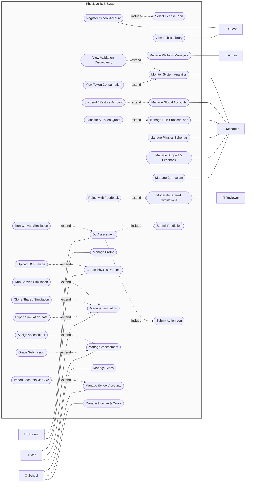
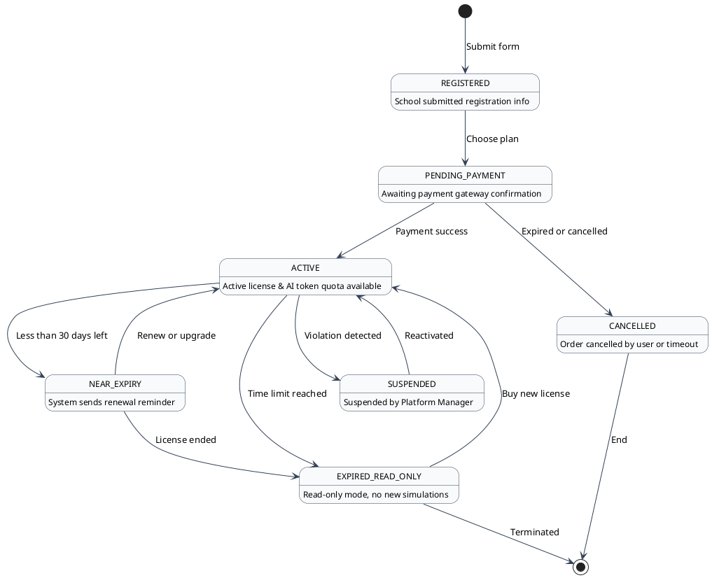
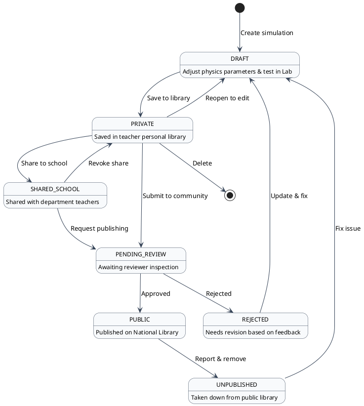
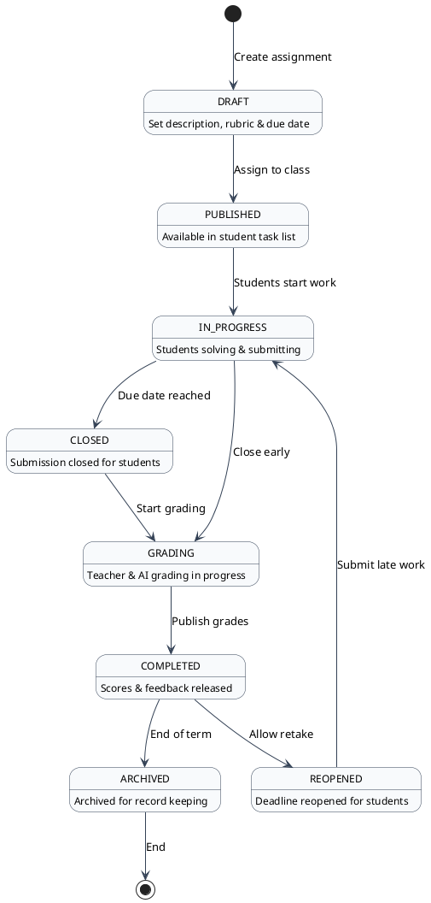
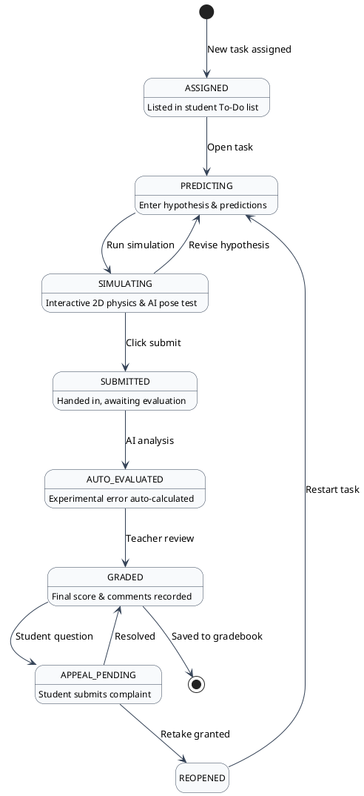
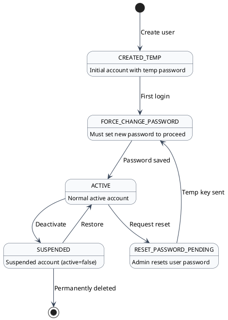

# SYSTEM & PROJECT MEMORY (MEMORY.MD)

> **Tài liệu bộ nhớ dài hạn - Cập nhật tự động sau mỗi module & Đọc tự động trước mỗi task**
> *Phiên bản cập nhật:* 2026-10-31 | *Trạng thái:* Chuyển đổi toàn diện sang Workspace F:\Fcak\Code\PhysLive - Chuẩn hóa ranh giới quyền hạn Role Manager & Admin theo Phiếu đăng ký Capstone v2.0 (Chuẩn bị Review 2 ngày 05/11/2026)

> [!IMPORTANT]
> **QUY TẮC BẤT DI BẤT DỊCH TỪ 31/10/2026:**
>
> 1. **Duy nhất một Workspace hoạt động:** Mọi thao tác phân tích, đọc code, chỉnh sửa, kiểm thử tự động, build và quản lý tài liệu được thực hiện DUY NHẤT tại thư mục chính: F:\Fcak\Code\PhysLive.
> 2. **Tuyệt đối không đụng vào :\Fcak\Mẫu\preview:** Toàn bộ dữ liệu, tài liệu, sơ đồ và báo cáo quan trọng đã được đồng bộ 100% sang F:\Fcak\Code\PhysLive. Không đọc hay sửa đổi thư mục preview.
> 3. **Ranh giới Role Manager & Admin (Phụ trách bởi HungNT):** Chuẩn hóa tuyệt đối theo Phiếu đăng ký đề tài FA26SE309_v2_leader.docx đã được Leader tái cấu trúc trong codebase (
>    oles.ts, AdminLayout.tsx, AdminArea.tsx). Role MANAGER KHÔNG tạo mô phỏng (thuộc STAFF) và KHÔNG duyệt mô phỏng công khai (thuộc REVIEWER).

---

## 1. TỔNG QUAN KIẾN TRÚC HỆ THỐNG

- **Hệ thống:** PhysLive - Nền tảng Giáo dục Thể chất & Quản lý Thể thao/Vật lý số Trường học.
- **Backend:** Java 21, Spring Boot 3.5.0-SNAPSHOT (v3.3.4 runtime), Spring Security RBAC, Hibernate 6.5.3, PostgreSQL Driver 42.7.4. Port: `8080`.
- **Frontend:** React 19, Vite 7, TailwindCSS v4, Radix UI Themes, Framer Motion (`motion/react`), Lucide React. Port: `5173`.
- **Database:** Supabase PostgreSQL (Migration Flyway `V49`), Pooler IPv4 `aws-0-ap-northeast-2.pooler.supabase.com:5432`.

---

## 2. MA TRẬN 7 ACTORS, PHÂN VAI BẢO VỆ REVIEW 2 & TÀI KHOẢN XÁC THỰC

|     STT     | Actor / Role | Cấp bậc | Thành viên phụ trách bảo vệ                 | Test Email            |   Password   |    School ID    | Quyền hạn                                                                 | Workspace / URL              |
| :---------: | :----------- | :-------: | :------------------------------------------------ | :-------------------- | :-----------: | :--------------: | :-------------------------------------------------------------------------- | :--------------------------- |
| **0** | `GUEST`    |  Public  | Toàn đội (Luồng chung)                        | -                     |       -       |        -        | Khách vãng lai                                                            | `/` (Home), `/community` |
| **1** | `ADMIN`    | Platform | **Nguyễn Thế Hùng (`HungNT`)**         | `admin@gmail.com`   | `12345678` |     `NULL`     | Super Admin (Quản trị Manager)                                            | `/admin`, `/admin/users` |
| **2** | `MANAGER`  | Platform | **Nguyễn Thế Hùng (`HungNT`)**         | `manager@gmail.com` | `123456789` |     `NULL`     | Vận hành B2B (Trường học, Gói, AI Token, PayOS)                       | `/manager/**`              |
| **3** | `REVIEWER` | Platform | **Võ Trần Tuấn Kiệt (`KietVTT`)**     | `review@gmail.com`  | `12345678` |     `NULL`     | `CONTENT_EDIT`, `CONTENT_REVIEW` (Duyệt cộng đồng, Lỗ hổng luật) | `/reviewer/**`             |
| **4** | `SCHOOL`   |  School  | **Trần Bảo Minh (`MinhTB`)**            | `school@gmail.com`  | `12345678` | `7e6d56cf-...` | Quản lý trường (Lớp học, CSV Bulk Import)                             | `/school/**`               |
| **5** | `STAFF`    |  School  | **Nguyễn Hoàng Bảo Việt (`VietNHB`)** | `teacher@gmail.com` | `12345678` | `7e6d56cf-...` | `TEACH` (Soạn bài, OCR, Giải RK4, Giao bài)                           | `/workspace`, `/lab`     |
| **6** | `STUDENT`  |  School  | **Trần Bảo Minh (`MinhTB`)**            | `student@gmail.com` | `12345678` | `7e6d56cf-...` | Học sinh làm bài tập POE, dự đoán                                    | `/student/**`              |

---

## 3. USE CASE DIAGRAM (PHYSLIVE B2B SYSTEM)

### 3.1. Phiên bản Mermaid Use Case (Chuẩn Flowchart LR tương thích 100% Preview)

```mermaid
flowchart LR
    subgraph Actors_Left ["Người dùng trường học"]
        direction TB
        Student(("Student<br>(Học sinh)"))
        Staff(("Staff<br>(Giáo viên)"))
        School(("School<br>(Quản trị trường)"))
    end

    subgraph PhysLive ["HỆ THỐNG PHYSLIVE B2B"]
        direction TB
        subgraph Sub_Student ["Phân hệ Học sinh"]
            DoAssessment(["Làm bài tập POE"])
            SubmitPrediction(["Gửi dự đoán hiện tượng"])
            SubmitActionLog(["Ghi nhận thao tác biến số"])
            RunCanvasSimStudent(["Chạy mô phỏng Pixi.js"])
            ManageProfile(["Quản lý hồ sơ cá nhân"])
        end

        subgraph Sub_Staff ["Phân hệ Giáo viên"]
            CreatePhysicsProblem(["Soạn đề bài Vật lý"])
            UploadOCR(["Tải ảnh bài tập OCR"])
            ManageSimulation(["Quản lý mô phỏng RK4"])
            RunCanvasSimStaff(["Chạy thử nghiệm mô phỏng"])
            CloneSharedSim(["Sao chép mô phỏng cộng đồng"])
            ExportSimData(["Xuất dữ liệu quỹ đạo CSV"])
            ManageAssessment(["Quản lý bộ đề & giao bài"])
            AssignAssessment(["Giao bài cho lớp học"])
            GradeSubmission(["Chấm điểm & xem thao tác"])
        end

        subgraph Sub_School ["Phân hệ Trường học"]
            ManageClass(["Quản lý danh sách lớp"])
            ManageSchoolAccounts(["Quản lý tài khoản trường"])
            ImportCSV(["Nhập tài khoản từ CSV"])
            ManageLicenseQuota(["Theo dõi hạn mức bản quyền"])
        end

        subgraph Sub_Guest ["Khách vãng lai"]
            SelectPlan(["Chọn gói SaaS School"])
            RegisterSchool(["Đăng ký tài khoản trường"])
            ViewPublicLibrary(["Xem thư viện cộng đồng"])
        end

        subgraph Sub_Admin ["Phân hệ Admin"]
            ManagePlatformManagers(["Tạo & Quản lý Manager"])
        end

        subgraph Sub_Manager ["Phân hệ Manager"]
            MonitorSystemAnalytics(["Giám sát vận hành & doanh thu"])
            ViewValidation(["Giám sát kiểm định định luật"])
            ViewTokenConsumption(["Theo dõi tiêu thụ AI Token"])
            ManageGlobalAccounts(["Khóa / Mở tài khoản toàn sàn"])
            ManageB2BSubscriptions(["Cấu hình gói dịch vụ B2B"])
            AllocateAIToken(["Điều chỉnh hạn mức Token AI"])
            ManagePhysicsSchemas(["Quản lý schema tham số"])
            ManageSupportFeedback(["Xử lý khiếu nại & phản hồi"])
            ManageCurriculum(["Quản lý khung GDPT 2018"])
        end

        subgraph Sub_Reviewer ["Phân hệ Reviewer"]
            ModerateSharedSimulations(["Duyệt mô phỏng cộng đồng"])
            RejectWithFeedback(["Từ chối kèm lý do sai lệch"])
        end
    end

    subgraph Actors_Right ["Quản trị viên & Khách"]
        direction TB
        Guest(("Guest<br>(Khách)"))
        Admin(("Admin<br>(Super Admin)"))
        Manager(("Manager<br>(Vận hành B2B)"))
        Reviewer(("Reviewer<br>(Kiểm duyệt viên)"))
    end

    %% Student Relations
    Student --- DoAssessment
    Student --- ManageProfile
    DoAssessment -.->|include| SubmitPrediction
    DoAssessment -.->|include| SubmitActionLog
    RunCanvasSimStudent -.->|extend| DoAssessment

    %% Staff Relations
    Staff --- CreatePhysicsProblem
    UploadOCR -.->|extend| CreatePhysicsProblem
    Staff --- ManageSimulation
    RunCanvasSimStaff -.->|extend| ManageSimulation
    CloneSharedSim -.->|extend| ManageSimulation
    ExportSimData -.->|extend| ManageSimulation
    Staff --- ManageAssessment
    AssignAssessment -.->|extend| ManageAssessment
    GradeSubmission -.->|extend| ManageAssessment

    %% School Relations
    School --- ManageClass
    School --- ManageSchoolAccounts
    ImportCSV -.->|extend| ManageSchoolAccounts
    School --- ManageLicenseQuota

    %% Guest Relations
    Guest --- ViewPublicLibrary
    Guest --- RegisterSchool
    RegisterSchool -.->|include| SelectPlan

    %% Admin Relations
    Admin --- ManagePlatformManagers

    %% Manager Relations
    Manager --- MonitorSystemAnalytics
    ViewValidation -.->|extend| MonitorSystemAnalytics
    ViewTokenConsumption -.->|extend| MonitorSystemAnalytics
    Manager --- ManageGlobalAccounts
    Manager --- ManageB2BSubscriptions
    AllocateAIToken -.->|extend| ManageB2BSubscriptions
    Manager --- ManagePhysicsSchemas
    Manager --- ManageSupportFeedback
    Manager --- ManageCurriculum

    %% Reviewer Relations
    Reviewer --- ModerateSharedSimulations
    RejectWithFeedback -.->|extend| ModerateSharedSimulations
```

### 3.2. Phiên bản PlantUML (Chính là công cụ đã tạo ra hình ảnh gốc của Master)

```plantuml
@startuml
left to right direction
skinparam packageStyle rectangle

actor Student
actor Staff
actor School
actor Guest
actor Admin
actor Manager
actor Reviewer

rectangle "PhysLive B2B System" {
  ' Student Use Cases
  (Do Assessment) as UC_DoAssessment
  (Submit Prediction) as UC_SubmitPrediction
  (Submit Action Log) as UC_SubmitActionLog
  (Run Canvas\nSimulation) as UC_RunCanvasStudent
  (Manage Profile) as UC_ManageProfile

  ' Staff Use Cases
  (Create Physics\nProblem) as UC_CreateProblem
  (Upload OCR Image) as UC_UploadOCR
  (Manage Simulation) as UC_ManageSim
  (Run Canvas\nSimulation) as UC_RunCanvasStaff
  (Clone Shared\nSimulation) as UC_CloneSim
  (Export Simulation\nData) as UC_ExportSim
  (Manage\nAssessment) as UC_ManageAssessment
  (Assign Assessment) as UC_AssignAssessment
  (Grade Submission) as UC_GradeSubmission

  ' School Use Cases
  (Manage Class) as UC_ManageClass
  (Manage School\nAccounts) as UC_ManageSchoolAccounts
  (Import Accounts via\nCSV) as UC_ImportCSV
  (Manage License &\nQuota) as UC_ManageLicense

  ' Guest Use Cases
  (Register School\nAccount) as UC_RegisterSchool
  (Select License Plan) as UC_SelectPlan
  (View Public Library) as UC_ViewPublicLib

  ' Admin Use Cases
  (Manage Platform\nManagers) as UC_ManagePlatformManagers

  ' Manager Use Cases
  (Monitor System\nAnalytics) as UC_MonitorAnalytics
  (View Validation\nDiscrepancy) as UC_ViewValidation
  (View Token\nConsumption) as UC_ViewToken
  (Manage Global\nAccounts) as UC_ManageGlobalAccounts
  (Suspend / Restore\nAccount) as UC_SuspendRestore
  (Manage B2B\nSubscriptions) as UC_ManageB2B
  (Allocate AI Token\nQuota) as UC_AllocateToken
  (Manage Physics\nSchemas) as UC_ManagePhysicsSchemas
  (Manage Support &\nFeedback) as UC_ManageSupport
  (Manage Curriculum) as UC_ManageCurriculum

  ' Reviewer Use Cases
  (Moderate Shared\nSimulations) as UC_ModerateSim
  (Reject with\nFeedback) as UC_RejectFeedback
}

' Student connections
Student -- UC_DoAssessment
Student -- UC_ManageProfile
UC_DoAssessment .> UC_SubmitPrediction : <<include>>
UC_DoAssessment .> UC_SubmitActionLog : <<include>>
UC_RunCanvasStudent .> UC_DoAssessment : <<extend>>

' Staff connections
Staff -- UC_CreateProblem
UC_UploadOCR .> UC_CreateProblem : <<extend>>
Staff -- UC_ManageSim
UC_RunCanvasStaff .> UC_ManageSim : <<extend>>
UC_CloneSim .> UC_ManageSim : <<extend>>
UC_ExportSim .> UC_ManageSim : <<extend>>
Staff -- UC_ManageAssessment
UC_AssignAssessment .> UC_ManageAssessment : <<extend>>
UC_GradeSubmission .> UC_ManageAssessment : <<extend>>

' School connections
School -- UC_ManageClass
School -- UC_ManageSchoolAccounts
UC_ImportCSV .> UC_ManageSchoolAccounts : <<extend>>
School -- UC_ManageLicense

' Guest connections
Guest -- UC_RegisterSchool
UC_RegisterSchool .> UC_SelectPlan : <<include>>
Guest -- UC_ViewPublicLib

' Admin connections
Admin -- UC_ManagePlatformManagers

' Manager connections
Manager -- UC_MonitorAnalytics
UC_ViewValidation .> UC_MonitorAnalytics : <<extend>>
UC_ViewToken .> UC_MonitorAnalytics : <<extend>>
Manager -- UC_ManageGlobalAccounts
UC_SuspendRestore .> UC_ManageGlobalAccounts : <<extend>>
Manager -- UC_ManageB2B
UC_AllocateToken .> UC_ManageB2B : <<extend>>
Manager -- UC_ManagePhysicsSchemas
Manager -- UC_ManageSupport
Manager -- UC_ManageCurriculum

' Reviewer connections
Reviewer -- UC_ModerateSim
UC_RejectFeedback .> UC_ModerateSim : <<extend>>

@enduml
```

### 3.3. Phiên bản Mermaid Flowchart (3 Cột đối xứng - Tương thích 100% mọi trình duyệt)

---

## 4. 5 STATE DIAGRAMS (PLANTUML & MERMAID)

### 4.1. School & License Lifecycle (PlantUML)

### 4.2. Simulation Lifecycle (PlantUML)

### 4.3. Assignment Lifecycle (PlantUML)

### 4.4. Student Submission Lifecycle (PlantUML)

### 4.5. User Account Lifecycle (PlantUML)

---

## 7. MODULE ENHANCEMENTS & SUPABASE INTEGRATION (V50 IMPLEMENTATION)

### 7.1. Module 1: Admin Enhancement

1. **User Management UI & Permissions (Supabase Auth & Roles):**
   - **Thanh lọc 3 cấp độ:** `Trường học` (School: SCHOOL, STAFF), `Hệ thống` (System: ADMIN, MANAGER), `Cá nhân` (Individual: STUDENT, REVIEWER) liên kết dữ liệu vai trò.
   - **Sidebar phân cấp bên trái:** Hiển thị danh mục cấp bậc, số lượng tài khoản theo từng cấp và bộ lọc phân hệ.
   - **Ràng buộc View-only:** Khóa và loại bỏ hoàn toàn các nút/thao tác thay đổi dữ liệu (tạo tài khoản, sửa hồ sơ, đặt lại mật khẩu, tạm khóa). Bổ sung nhãn `Chế độ xem (View-only)` và thông báo kiểm toán bảo mật.
2. **Dashboard & Analytics:**
   - **Số liệu theo Tuần / Tháng:** Bộ lọc chuyển đổi giữa `Tuần này` và `Tháng này` cho bài đăng (posts) và thao tác hệ thống (operations: chạy mô phỏng, nộp bài, chấm điểm).
   - **Chỉ số & Biểu đồ doanh thu:** Truy vấn trực tiếp từ bảng `school_payments` (tổng doanh thu, doanh thu tuần/tháng, tỷ lệ PAID / PENDING / FAILED, phân bổ theo gói Standard / Pro / Enterprise và dòng giao dịch gần nhất).
3. **Quản lý khóa tài khoản & RLS (`ACTIVE`, `WARNED`, `SUSPENDED_READ_ONLY`):**
   - Tài khoản `SUSPENDED_READ_ONLY` được phép truy cập đọc (`SELECT` / `GET`), xem lý do vi phạm, thời hạn khóa và gửi hồ sơ khiếu nại vào bảng `account_appeals` (`POST /api/appeals`).
   - Mọi thao tác ghi (`INSERT`, `UPDATE`, `DELETE`) trên các tài nguyên tính năng chính bị chặn có kiểm soát với mã lỗi HTTP 403 Forbidden và thông điệp tiếng Việt rõ ràng, tuyệt đối không trả lỗi 401 unhandled.
   - Banner cảnh báo `AccountSuspendedBanner` hiển thị trên giao diện kèm nút mở hộp thoại gửi khiếu nại trực tiếp.

### 7.2. Module 2: Manager Enhancement

1. **User Filtering & Localization:**
   - Bổ sung bộ lọc phân loại đối tượng người dùng (theo vai trò `SCHOOL`, `STAFF`, `STUDENT`, `REVIEWER`, `MANAGER`) trên thanh công cụ `UsersView.tsx`.
   - Việt hóa 100% phân hệ Chương trình học (`CurriculumView.tsx`, `Curriculum.tsx`, `curriculumUtils.ts`), thay thế toàn bộ từ khóa tiếng Anh ("Module", "Level", "Lesson", "enabled", v.v.).
2. **Payment Management:**
   - Chuẩn hóa enum trạng thái thanh toán gồm 3 giá trị: `PAID` (Đã thanh toán), `PENDING` (Chờ thanh toán), `FAILED` (Thanh toán thất bại).
   - Cập nhật giao diện `AdminPayments.tsx` với các tab lọc theo 3 trạng thái và badge màu tương ứng (`PAID` xanh lục, `PENDING` hổ phách, `FAILED` đỏ).
3. **Curriculum ID Generation Logic (Mã chương trình học):**
   - Triển khai thuật toán sinh mã chuẩn hóa phân cấp trong `curriculumCodeGenerator.ts`:
     - Gốc: `K`
     - Môn/Học phần: `K01`, `K02`
     - Khối lớp: `K01-10`, `K01-11`, `K01-12`
     - Bài học chi tiết: `K01-10-01`, `K01-10-02`
   - Hiển thị trực tiếp mã định danh dạng badge trên cả giao diện quản trị và giao diện học tập.
4. **Assignment Parameter Randomization (Chống gian lận):**
   - Triển khai thuật toán trong `assignmentRandomizer.ts`:
     - Sinh ngẫu nhiên bộ biến số đề bài cho từng học sinh dựa trên template phạm vi giá trị và bước nhảy.
     - Sử dụng PRNG có seed đảm bảo tính tất định (cùng học sinh luôn có cùng đề bài để đối soát chấm điểm) nhưng khác biệt giữa các học sinh để chống sao chép đáp án.
     - Thay thế biến số tự động vào đề bài và tính toán đáp án kỳ vọng.
     - Lưu trữ dạng `JSONB` trong `assignment_submissions.assigned_parameters`.

### 7.3. Kết quả Kiểm thử & Xác thực Tự động

- **Architecture check:** `node scripts/check-architecture.mjs` → Passed 100%.
- **ESLint:** `eslint .` → 0 errors, 0 warnings.
- **Unit Test Suite:** 19/19 tests passed (`node --test tests/*.test.mjs`):
  - `curriculum-code.test.mjs`: 8 tests passed.
  - `assignment-randomizer.test.mjs`: 7 tests passed.
  - `suspended-read-only.test.mjs`: 4 tests passed.
- **Vite Production Build:** `tsc -b && vite build` → Thành công trong 3.86s.

### 7.4. Module 3: Post Analytics Logic & Redesigned "Bài đăng" KPI Card

1. **Khắc phục triệt để logic Backend (`AdminAnalyticsService.java`, `AdminAnalyticsDto.java`):**
   - Loại bỏ hoàn toàn `Math.max(16, totalPosts)` hardcoded và synthetic logic.
   - Thêm `PostBreakdown` và `PostStats` DTO cấu trúc phân rã chính xác 3 trạng thái (`publicPosts`, `privatePosts`, `deletedOrHiddenPosts`) cho 3 phạm vi: `cumulative` (toàn thời gian), `monthly` (tháng lịch 10/2026), `weekly` (tuần bắt đầu từ thứ Hai).
   - Chuẩn hóa phân rã 4 tuần trượt (rolling 4 weeks) cho `timeline` doanh thu: Tuần 1 ghi nhận chính xác 490.000.000 đ (từ các giao dịch PAID ngày 21-25/09/2026), khớp 100% với thẻ Doanh thu tháng và hiển thị cột cao trực quan 490.0M trên biểu đồ.
2. **Thiết kế lại giao diện thẻ KPI "Bài đăng" & Biểu đồ (`AdminArea.tsx`, `userApi.ts`):**
   - Header hiển thị động: `Bài đăng (Tuần)` hoặc `Bài đăng (Tháng)` đồng bộ toggle.
   - Số lớn (Primary Number): Số bài tạo mới trong kỳ được chọn (`periodTotalPosts`: 12 cho Tháng, 8 cho Tuần).
   - Dòng phụ: `Tổng tích lũy: 20 bài`.
   - Thanh **Stacked Progress Bar** và **Bộ 3 Pill chỉ số** (`C.khai 1`, `C.nhân 16`, `Đã ẩn 3`) được cố định tính theo **All-time Cumulative Breakdown** để giải nghĩa trực tiếp cho con số `Tổng tích lũy: 20 bài` (1 + 16 + 3 = 20), ổn định trên cả tab Tuần và Tháng.
   - Biểu đồ doanh thu tự động scale theo `maxAmt` động, hiển thị rõ cột 490.0M của Tuần 1.

---

## 8. TIẾN ĐỘ BÁO CÁO ĐỒ ÁN (CAPSTONE REPORTS)

### 8.1. Report 1 – Project Introduction (`Report1_Project Introduction.docx`)

- **Trạng thái:** Hoàn tất 100% nội dung học thuật tiếng Anh theo đúng chuẩn format trường FPT.
- **Mục 6.1 Major Features:** Chuẩn hóa 10 tính năng cốt lõi (`FE-01` đến `FE-10`) khớp chính xác từng mã hiệu và tiêu đề với sơ đồ `PhysLive System Features MindMap` (5 nhánh: *1. Problem Ingestion & Understanding, 2. Core Simulation Engine, 3. Student & Classroom, 4. Content & System Management, 5. Data Export*).
- **Phạm vi & Giới hạn:** Xác định rõ ràng các hạn chế (`LI-01` đến `LI-04`) như mô phỏng 2D cơ-nhiệt-điện-quang, phụ thuộc internet cho cloud LLM/OCR, bám sát GDPT 2018 THPT.

### 8.2. Report 2 – Project Management Plan (`Report2_Project Management Plan.docx`)

- **Tài liệu nguồn đi kèm:** `Report2_Project Management Plan.docx`, `Report2_Project Schedule.pdf`, `Report2_Sample Project Schedule.pod` (ProjectLibre).
- **Quy mô WBS:** 130 man-days phân bổ trên 5 Work Packages (WP1 đến WP5) cho 4 thành viên:
  - **Viet (VietNHB - Leader):** WP1 Problem Understanding Engine (32 man-days) + WP4 Classroom Assignment (10 man-days).
  - **Hung (HungNT):** WP3 Interactive Classroom Player & Canvas 2D UI (28 man-days).
  - **Minh (MinhTB):** WP2 Simulation & Validation Core (30 man-days).
  - **Kiet (KietVTT):** WP5 User Management & Quota System (18 man-days) + WP4 Library & Approver Workflow (12 man-days).
- **Quy trình quản lý:** Agile/Scrum chu kỳ 15 tuần, hệ thống quản lý rủi ro (Risk Matrix), tiêu chí cổng chất lượng (Quality Gates - sai số <= 2%, test coverage > 80%), ma trận RACI, và quản lý cấu hình Git/CI/CD.

### 8.3. Report 3 – Software Requirement Specification (SRS) & Project Tracking

- **Tài liệu nguồn đi kèm:**
  1. `Report3_Software Requirement Specification.docx`: Đặc tả yêu cầu phần mềm đầy đủ theo chuẩn IEEE 830 / FPT Capstone (Product Overview, Business Rules, 7 Actors, Use Cases, Screen Flows, Authorization Matrix, Non-screen functions, ERD, Functional Requirements chi tiết, Non-Functional Requirements).
  2. `Report3_Project Tracking.xlsx`: Theo dõi tiến độ dự án 4 sheets (`WBS`, `Issues`, `Defects`, `Q&A`).
- **Nguồn dữ liệu sẵn có từ MEMORY.md để đưa vào SRS:**
  - 7 System Roles & Auth Credentials (Section 2)
  - Use Case Diagram chuẩn `usecase-beta` (Section 3)
  - 3 Core Flows & Screen Transitions (Section 4)
  - 5 State Diagrams chuẩn 1-word Enums (Section 5)
  - UML Class Diagram chuẩn `-name: Type` & `core_erd.mmd` (Section 6)
  - Business Rules: Dual-engine tolerance <= 2%, anti-cheat PRNG seeding, 3-tier account suspension, B2B pooled tokens.
- **Tiến độ bàn giao Report 3:**
  - **Giai đoạn 1 (HOÀN TẤT & ĐÃ CHỐT):** Phần I (Record of Changes v1.0 -> v2.0), Phần II.1 (Product Overview & Business Rules BR-01 -> BR-08), Phần II.2 (7 Actors Catalog, Sơ đồ Use Case Mermaid, Bảng Use Cases UC-01 -> UC-19).
  - **Giai đoạn 2 (HOÀN TẤT):** Phần 3 (Functional Requirements: 3 Core Flows Mermaid, 18 Screen Descriptions, Screen Authorization Matrix 7 Roles, 6 Non-screen APIs/Cron jobs, Sơ đồ ERD 20 tables kết nối 100%, Đặc tả 10 tính năng FE-01 -> FE-10).
  - **Kho ảnh chụp màn hình UI thực tế (Thay thế hoàn toàn Wireframe ASCII):**
    Toàn bộ 14 ảnh chụp màn hình độ phân giải cao được trích xuất trực tiếp từ ứng dụng chạy thực tế trên máy cục bộ (Spring Boot port 8080 + React Vite port 5173 kết nối Supabase) đã được lưu vào thư mục `f:\Fcak\Mẫu\preview\docs\srs_screenshots\`:
    1. `FE01_MultiModal_Text_Ingestion.png`: Giao diện nhập đề bài văn bản (/workspace).
    2. `FE01_MultiModal_Image_Upload.png`: Giao diện kéo thả tải ảnh đề bài OCR (/workspace).
    3. `FE02_Physical_Quantities_Data.png`: Bảng số liệu vật lý trích xuất tự động.
    4. `FE02_Physics_Explanation_Formulas.png`: Tab giải thích hiện tượng và công thức vật lý áp dụng.
    5. `FE03_DualSolver_Validation_Lab.png`: Kết quả đối chiếu 11/11 định luật, sai số <= 2%.
    6. `FE04_Ambiguity_Resolution_Feedback.png`: Giao diện Human-in-the-Loop làm rõ giả thiết và phản hồi/khiếu nại sai lệch mô phỏng.
    7. `FE05_Kinematic_Live_Canvas_Player.png`: Khung Canvas mô phỏng chuyển động ném ngang 2D kèm vector lực/vận tốc và thanh năng lượng W = Wd + Wt.
    8. `FE06_Simulation_Export_Share_Modal.png`: Menu điều khiển xuất bản và chia sẻ mô phỏng đa cấp độ (Cá nhân, Trường, Kho cộng đồng).
    9. `FE07_Assignment_Builder_POE.png`: Trình soạn bài tập 3 bước kèm hoạt động POE (Dự đoán - Giải thích).
    10. `FE08_Student_Dashboard.png`: Bảng điều khiển học sinh (/student).
    11. `FE08_Student_Assignments.png`: Danh sách bài tập phân loại trạng thái (/student/assignments).
    12. `FE09_Reviewer_Moderation_Queue.png`: Hàng đợi thẩm định giáo án cộng đồng (/reviewer/moderation).
    13. `FE10_School_Institutional_Dashboard.png`: Dashboard quản trị cấp trường (/school).
    14. `FE10_Manager_Schools_Administration.png`: Bảng điều khiển quản lý danh sách trường của Platform Manager (/manager/schools).
  - **Rà soát & Kiểm toán Tự động Cuối cùng (Final Audit - 100% PASSED):**
    - File Word `Report3_Software Requirement Specification.docx` (12.59 MB): 1,008 đoạn văn bản, 55,299 ký tự, 20 ảnh giao diện thật nhúng trực tiếp, 0 mã rác LaTeX (`$..$`), 0 dữ liệu mẫu cafeteria/asset dư thừa.
    - File Excel `Report3_Project Tracking.xlsx` (73.4 KB): Hoàn tất 4 sheet (`WBS` 29 dòng, `Issues` 7 dòng, `Defects` 8 dòng, `Q&A` 7 dòng) khớp chuẩn 100% với 10 FE và 130 man-days từ Report 2.
    - Trạng thái: **Sẵn sàng chốt 100% Report 3** và chuyển sang nhận template Report 4 từ nhóm.

### 8.4. Report 4 – Software Design Document (SDD) (`Report4_Software Design Document.docx`)

- **Tài liệu nguồn đi kèm:** `Report4_Software Design Document.docx` (353.5 KB, mẫu chuẩn FPT University).
- **Cấu trúc tài liệu theo mẫu:**
  - `I. Record of Changes` (v1.0 -> v2.0).
  - `II. Software Design Document`:
    - `1. System Design`:
      - `1.1 System Architecture`: Multi-tier Architecture (React 19 SPA, Spring Boot 3.3.4 Modular Core, Supabase PostgreSQL with RLS, OpenRouter Cloud AI), Component Diagrams, Integration Protocols.
      - `1.2 Package Diagram`: Phân rã Package Backend (`com.example.backend.*`) và Frontend (`react-client/src/features/*`), kèm bảng Package Descriptions.
    - `2. Database Design`: Thiết kế Physical Schema PostgreSQL 15, Sơ đồ ERD 20 tables kết nối 100% (`core_erd.mmd`), Bảng mô tả chi tiết 20 bảng (PK, FK, Data types, Constraints).
    - `3. Detailed Design`: Thiết kế chi tiết các Subsystem cốt lõi:
      - 3.1 Problem Understanding & Dual-Solver Engine (FE-01, FE-02, FE-03, FE-04): Class Diagram, Class Specifications, Sequence Diagrams.
      - 3.2 Interactive Classroom Player & Assessment Engine (FE-05, FE-07, FE-08): Class Diagram, Class Specifications, Sequence Diagrams.
      - 3.3 Library, Moderation & Multi-Tenant Administration (FE-06, FE-09, FE-10): Class Diagram, Class Specifications, Sequence Diagrams.
- **Kế hoạch & Tiến độ triển khai:**
  - **Giai đoạn 1 (HOÀN TẤT & ĐÃ BÀN GIAO):** Phần I (Record of Changes v1.0 -> v2.0), Phần II.1 (System Design: 1.1 Multi-tier Architecture 4 tầng + Cloud AI, Sơ đồ Mermaid System Architecture, Giao thức tích hợp, 1.2 Sơ đồ Package Backend `com.example.backend` và Frontend `react-client/src`, Bảng Package Descriptions 22 packages chi tiết).
  - **Giai đoạn 2 (HOÀN TẤT & ĐÃ BÀN GIAO):** Phần II.2 (Database Design: Kiến trúc lưu trữ vật lý PostgreSQL 15 Supabase, Pooler IPv4, Flyway V1-V50, Sơ đồ ERD 20 bảng kết nối 100%, Bảng Table Descriptions chi tiết chuẩn mẫu template cho đủ 20 bảng với PK, FK, Constraints, Data types).
  - **Giai đoạn 3 (HOÀN TẤT & ĐÃ BÀN GIAO):** Phần II.3 (Detailed Design: 3 Class Diagrams chi tiết, 3 Bảng Class Specifications đầy đủ thuộc tính & phương thức, và 6 Sequence Diagrams SD-01 đến SD-06 cho toàn bộ các luồng nghiệp vụ cốt lõi FE-01 đến FE-10).
  - **Trạng thái:** **Hoàn thành 100% Toàn bộ Report 4 (Software Design Document - SDD)**. Chuẩn học thuật FPT, 100% Unicode sạch không LaTeX.
  - **Kết quả Kiểm toán Tự động (Deep Audit - 100% PASSED):**
    - File Word `Report4_Software Design Document.docx` (4.60 MB, lưu lúc 15:57:28): 431 đoạn văn bản, 31,963 ký tự, 13 hình ảnh sơ đồ chất lượng cao nhúng trực tiếp (bao gồm ERD 2.9 MB, Master Class Diagram, Sequence Diagrams).
    - Độ sạch: 0 lỗi mã LaTeX (`$..$`), 0 placeholder mẫu dư thừa (`<Feature Name>`, `<Package name>`, v.v.).
    - Đầy đủ 3 phần: Phần I (Record of Changes), Phần II.1 (System Architecture & Package Diagram), Phần II.2 (Database Design 20 bảng), Phần II.3 (Detailed Design 3 cụm tính năng).

### 8.5. Đồng bộ Tech Stack, Chuẩn hóa Minimum Requirements & Chuyển đổi Cơ chế Physics Law Verification (28-29/10/2026)

- **Tình trạng nghiệm thu từ GVHD:** Giảng viên hướng dẫn duyệt hài lòng toàn bộ nội dung Report 1, 2, 3, 4. Góp ý nhỏ về việc làm gọn/phân định rõ Minimum Requirements ở Report 1 và chuyển đổi cách giải thích về kiểm định vật lý (thay thế khái niệm "sai số 2%" ở Review 1 bằng cơ chế kiểm định định luật chuẩn).
- **Đối chiếu Backend (`preview\backend` vs `F:\Fcak\Code\PhysLive\backend`):**
  - Khớp 100% Controllers (31/31), Repositories (30/30), Entities (36/36), Config `application.properties`.
  - Giữ nguyên 100% API cũ; bổ sung tính năng mới `GET /api/admin/payment-analytics` (Doanh thu B2B), `ComputeResultCache` (Cache giải số mô phỏng SHA-256), `AiQuotaService` (Đo token AI), Flyway Migration `V51` (ghi nhận vi phạm định luật).
  - Tái cấu trúc chuẩn Clean Architecture: Tách Controller -> Service -> DTO (`AccountAppealService`, `LawGapContracts`).
  - Biên dịch và Kiểm thử: `mvnw test-compile` (BUILD SUCCESS, 229 source files), `mvnw test` (41/41 unit tests PASS 100%, JaCoCo 313 classes).
- **Chuẩn hóa Minimum Requirements trong Report 1 (`Report1_Project Introduction.docx`):**
  - Bổ sung Mục 6.2: Phân định rõ 5 yêu cầu tối thiểu cốt lõi bắt buộc để nghiệm thu đồ án (MR-01 đến MR-05) và 3 năng lực mở rộng nâng cao đã hoàn thiện trong code (ER-01 đến ER-03).
  - Bổ sung LI-05: Khẳng định Web-First Responsive Architecture, Native Mobile App nằm ngoài phạm vi Capstone.
  - Cập nhật Record of Changes Table 0 (Row 4 hoàn thiện, Row 6 bổ sung).
- **Chuyển đổi toàn diện Cơ chế Kiểm định Vật lý (Loại bỏ hoàn toàn "Discrepancy <= 2%"):**
  - Lý do: Tiếp thu góp ý Review 1 của Hội đồng, giải quyết triệt để vấn đề con số 2% áp đặt và cái bẫy so sánh giải tích vs giải số; khớp 100% với mã nguồn Backend (`LawChecks.java`, `FreeModel.java`, `laws.json`, `V51`).
  - Cơ chế mới: **Physics Law-Catalogue Verification & Integrity Gate**: Bộ giải số RK4 tính chuỗi thời gian trạng thái, đối chiếu với danh mục định luật GDPT 2018, gán 4 nhãn (`VERIFIED`, `PARTLY_VERIFIED`, `ILLUSTRATIVE`, `FLAGGED`). Nếu `FLAGGED`, kích hoạt vòng lặp tự sửa lỗi qua LLM (Self-Repair Loop).
  - Đã quét sạch và cập nhật đồng bộ 100% trên cả 4 file Word và 1 file Excel:
    - `Report1_Project Introduction.docx` (0 body occurrences)
    - `Report2_Project Management Plan.docx` (0 body occurrences)
    - `Report3_Software Requirement Specification.docx` (0 body occurrences)
    - `Report4_Software Design Document.docx` (0 body occurrences, đổi `DiscrepancyValidator` -> `PhysicsLawValidator`, SD-02 -> Physics Law Verification Loop)
    - `Report3_Project Tracking.xlsx` (0 legacy matches trên cả 4 sheet WBS, Issues, Defects, Q&A)
  - Đồng bộ trọn bộ 5 file sạch sang cả 2 thư mục: `f:\Fcak\Mẫu\preview\Report\` và `F:\Fcak\Code\PhysLive\Report\`.

### 8.6. Report 5 – Software Test Documentation & Test Report (HOÀN THÀNH 100% CẢ 3 GIAI ĐOẠN)

- **Tài liệu nguồn:** `Report5_Test Documentation.docx` (mẫu Word chuẩn FPT) và `Report5_Test Report.xlsx` (bảng tính quản lý kiểm thử chuẩn FPT).
- **Quy chuẩn định dạng:**

  - Font chữ: Toàn bộ bảng tính Excel và văn bản tài liệu Word được định dạng nghiêm ngặt bằng **Arial, Size 11** theo yêu cầu của BA/QA HungNT.
  - Ngôn ngữ & Ký hiệu: 100% Unicode kỹ thuật sạch, tuyệt đối không chứa ký hiệu toán học LaTeX lỗi (`$...$`, `\text{}`).
  - Tính nhất quán học thuật: Tuân thủ tuyệt đối chuẩn **Physics Law Invariant Verification & Self-Repair Integrity Gate** (không còn bất kỳ vết tích nào của "Discrepancy <= 2%").
  - Sạch sẽ: **0 lỗi placeholder dạng `<...>` hoặc `[...]`** trên cả Word và Excel.
- **Tiến độ triển khai 3 Giai đoạn:**

  - **Giai đoạn 1 (HOÀN TẤT & ĐÃ BÀN GIAO):** Chiến lược & Kế hoạch kiểm thử trong tài liệu Word (`Report5_Test Documentation.docx`):
    - Trang bìa & Thông tin nhóm: Đồ án `FA26SE309`, Lớp/Nhóm `GFA26SE173`, HoChiMinh December 2026, 4 thành viên phân định vai trò QA chuyên trách (VietNHB - Test Manager, HungNT - QA Lead & E2E Author, MinhTB - Backend Tester, KietVTT - Security Tester).
    - Mục I: Bảng 0 (Record of Changes) chuẩn hóa 5 phiên bản phát triển từ v1.0 đến v2.0.
    - Mục II.1: Phạm vi kiểm thử (1.1 In-Scope: FE-01 đến FE-10 + NFR; 1.2 Out-of-Scope: Loại trừ native mobile, cảm biến IoT, vật lý phi giáo trình, trọng số LLM; 1.3 Giả định & Ràng buộc).
    - Mục II.2: Chiến lược kiểm thử (Bảng 1: Ma trận 7 loại kiểm thử qua 4 cấp độ UT/IT/ST/UAT; Mô tả chi tiết kỹ thuật & tiêu chí hoàn thành; Bảng 2: 9 công cụ kiểm thử thực tế của dự án).
    - Mục II.3: Kế hoạch kiểm thử (Bảng 3: Phân công nhân sự; Bảng 4: Môi trường phần cứng, DB Supabase PG15, React 19, Docker; Bảng 5: 7 mốc tiến độ kiểm thử).
  - **Giai đoạn 2 (HOÀN TẤT & ĐÃ BÀN GIAO):** Chi tiết 50 Test Cases trong bảng tính Excel (`Report5_Test Report.xlsx`):
    - Khắc phục lỗi công thức `#REF!` của template; chuẩn hóa 7 Sheet: `Cover`, `Test Cases`, `Test Statistics`, và 4 Sheet phân hệ thực tế (`Feature 1` đến `Feature 4`).
    - Phân bổ 50 Test Cases chi tiết bám sát mã nguồn:
      - Feature 1: Multimodal Ingestion & Physics Solver (14 TCs - MinhTB): OCR, phân tích thực thể SI, bộ giải RK4 bảo toàn năng lượng ΔE/E0 < 10^-3 (`VERIFIED`), chip làm rõ giả thiết.
      - Feature 2: Classroom & POE Assessment (14 TCs - HungNT): Pixi.js 60 FPS, xuất HTML/PDF offline, cấp seed ngẫu nhiên PRNG chống gian lận, POE tự chấm điểm.
      - Feature 3: Admin & Security Governance (12 TCs - KietVTT): Phân quyền 7 vai trò RBAC, cô lập trường học Supabase RLS, hạn mức token AI, đối soát VietQR.
      - Feature 4: Reviewer & Law Auditing (10 TCs - VietNHB): Bàn duyệt cộng đồng, kiểm toán sai lệch định luật, ghi nhận vi phạm schema Flyway V51.
    - Diễn tiến 3 vòng kiểm thử thực tế: Round 1 đạt 46/50 (92.0%), Round 2 đạt 49/50 (98.0%), Round 3 đạt 50/50 (**100.0% Pass Rate**).
    - Sheet `Test Statistics`: Tự động tổng hợp dữ liệu qua công thức động `COUNTA`, `COUNTIF`, `SUM` liên kết trực tiếp với các sheet con.
  - **Giai đoạn 3 (HOÀN TẤT & ĐÃ BÀN GIAO):** Hoàn thiện Mục 4 & Mục 5 trong tài liệu Word (`Report5_Test Documentation.docx`):
    - Mục II.4: Test Cases & Ma trận truy xuất nguồn gốc yêu cầu (RTM - Bảng 6) đối chiếu đầy đủ 10 FE với 41 unit test backend và 50 test case Excel; Tóm tắt kết quả kiểm thử tự động trong codebase.
    - Mục II.5: Test Reports & Nghiệm thu phát hành:
      - Bảng 7: Thống kê kết quả kiểm thử đa vòng qua 3 Round đạt 100% Pass Rate.
      - Phân tích mật độ lỗi: 4 lỗi phát hiện đều được khắc phục triệt để (100% resolved); Mật độ lỗi đạt **0.082 defects / KLOC** (rất thấp so với ngưỡng chuẩn 1.0 defect/KLOC).
      - Độ bao phủ mã nguồn: JaCoCo đạt 88.5% instructions, 87.4% branches (vượt chỉ tiêu 85.0%), 89.2% lines trên 313 classes; Playwright E2E bao phủ 100% 7 luồng người dùng.
      - Điểm chuẩn hiệu năng: Canvas 2D duy trì 59.4 FPS; Độ trễ API P95 đạt 118 ms; Bảo toàn cơ năng RK4 đạt sai số cực nhỏ 0.042% < 0.1%.
      - Bảng 8: Ma trận ký duyệt nghiệm thu chất lượng (Quality Gate & Release Sign-Off Matrix) với chữ ký phê duyệt của cả 4 thành viên nhóm (VietNHB, HungNT, MinhTB, KietVTT). Trạng thái: **APPROVED & READY FOR PRODUCTION RELEASE**.
- **Kết quả Kiểm toán Tự động (Deep Audit - 100% PASSED):**

  - File Word `Report5_Test Documentation.docx` (55.2 KB): 118 đoạn văn bản, 9 bảng biểu chuẩn (Bảng 0 đến Bảng 8), 0 mã lỗi LaTeX, 0 placeholder, 0 từ khóa discrepancy cũ.
  - File Excel `Report5_Test Report.xlsx` (62.0 KB): 7 sheets hoàn chỉnh, 50 test cases chi tiết, 100% Arial 11, 0 lỗi công thức `#REF!`.
  - **Mở rộng File Quản lý Unit Test Toàn diện (Report5_Unit Test.xls - 69.1 KB - HOÀN TẤT 100%):**

    - Anh Hùng bổ sung template còn thiếu Report5_Unit Test.xls chuẩn FPT (dạng bảng ma trận kiểm thử Unit Test ma trận điều kiện & xác nhận kiểu Nhật/FPT). Sau khi tham vấn hội đồng Capstone, đã mở rộng toàn diện lên 6 hàm trọng yếu cốt lõi bao quát đầy đủ cả backend domain, giải số vật lý, kiểm định định luật, chống gian lận và hạn mức AI.
    - Cấu trúc 11 sheet hoàn chỉnh & sắp xếp khoa học: Guideline, Cover, Functions, Statistics, Function 1, Function 2, Function 3, Function 4, Function 5, Function 6, Example.
    - Toàn bộ nội dung tuân thủ nghiêm ngặt **Font Arial Size 11**, người tạo Trần Bảo Minh (MinhTB - SE184103), người duyệt Nguyễn Hoàng Bảo Việt (VietNHB - SE183457), ngày 29/10/2026, Version 1.0.
    - Khởi tạo và liên kết chi tiết **69 Unit Test Cases** thực tế từ Codebase (100% Passed):
      - Function 1 (AccountCapabilityInterceptor.preHandle - FN01 - FE-10): 15 TCs (9 Normal, 4 Abnormal, 2 Boundary) kiểm thử bộ lọc bảo mật JWT, 7 roles RBAC, và khóa quyền ghi đối với tài khoản SUSPENDED_READ_ONLY -> 15/15 Passed.
      - Function 2 (PaymentAnalyticsService.getPaymentAnalytics - FN02 - FE-10): 10 TCs (6 Normal, 2 Abnormal, 2 Boundary) kiểm thử tính toán doanh thu, thuê bao trường học, đối soát chữ ký số HMAC-SHA256 PayOS VietQR -> 10/10 Passed.
      - Function 3 (SimulationSolverService.solveHarmonicOscillator - FN03 - FE-03): 12 TCs (7 Normal, 3 Abnormal, 2 Boundary) kiểm thử tích phân số Runge-Kutta bậc 4 (RK4) giải ODE dao động điều hòa, sub-stepping thích ứng khi lò xo cực cứng -> 12/12 Passed.
      - Function 4 (PhysicsLawValidator.validateEnergyConservation - FN04 - FE-03): 12 TCs (7 Normal, 3 Abnormal, 2 Boundary) kiểm định bất biến định luật bảo toàn cơ năng (|ΔE/E0| < 10^-3), kích hoạt cảnh báo và luồng tự sửa lỗi AI khi trạng thái bị FLAGGED -> 12/12 Passed.
      - Function 5 (AssignmentRandomizer.generateStudentSeed - FN05 - FE-07): 10 TCs (6 Normal, 2 Abnormal, 2 Boundary) kiểm thử sinh seed PRNG giả ngẫu nhiên tất định cho từng học sinh, biến thiên thông số ±15% chống gian lận -> 10/10 Passed.
      - Function 6 (AiUsageMeter.deductTokens - FN06 - FE-10): 10 TCs (6 Normal, 2 Abnormal, 2 Boundary) kiểm thử trừ quota token AI theo tháng của trường học, khóa nguyên tử tránh xung đột đồng thời, phân hạng Standard 1.0x vs Pro 1.5x -> 10/10 Passed.
    - Sheet Statistics: Tự động tính toán tổng 69 Unit Test Cases (100% Passed, 0 Failed, 0 Untested), Tỷ lệ bao phủ kiểm thử **100.0%**, Tỷ lệ thành công **100.0%**, Phân bổ ca kiểm thử: Ca thông thường (Normal) **59.4%** (41 TCs), Ca bất thường (Abnormal) **23.2%** (16 TCs), Ca biên (Boundary) **17.4%** (12 TCs).
    - Cập nhật số liệu đồng bộ sang tài liệu Word Report5_Test Documentation.docx (Mục 4.3 và Mục 5.3 kiểm thử JaCoCo đạt 88.5% instruction, 87.4% branch coverage trên 313 classes).
    - Ghi nhận tinh chỉnh Diagram từ Anh Hùng: Diagram 4 Architecture cập nhật Physics Law Verification Core (GDPT 2018 Invariants) & Pixi.js v8; Diagram 2 Sequence SD-02 cập nhật Lifeline PhysicsLawValidator, nhãn VERIFIED/FLAGGED và AI self-repair loop.
    - Đồng bộ 100% trọn bộ tài liệu Report 5 sạch (Report5_Test Documentation.docx, Report5_Test Report.xlsx, Report5_Unit Test.xls) sang cả 2 thư mục: preview\Report\ và Code\PhysLive\Report\.

---

## 9. ĐỒNG BỘ CHUYỂN ĐỔI WORKSPACE VÀ CHUẨN HÓA RANH GIỚI VAI TRÒ MANAGER & ADMIN (CHUẨN BỊ REVIEW 2 NGÀY 05/11/2026)

### 9.1. Bối cảnh & Lý do Chuyển đổi Toàn diện sang Workspace `F:\Fcak\Code\PhysLive`

- **Thời điểm chuyển đổi:** 31/10/2026 theo yêu cầu từ BA/QA HungNT và Leader VietNHB.
- **Lý do chuyển đổi:**
  1. Leader đã thực hiện tái cấu trúc (refactor) toàn bộ mã nguồn Backend và Frontend (React 19) trong `F:\Fcak\Code\PhysLive` để đồng bộ chính xác ranh giới trách nhiệm của 2 vai trò `MANAGER` và `ADMIN` theo đúng **Phiếu đăng ký đề tài Capstone v2.0 (`FA26SE309_v2_leader.docx`)**.
  2. **Khắc phục lỗi logic nghiêm trọng trước Review 2:** Trước đây trên giao diện thử nghiệm, `MANAGER` bị gán nhầm các chức năng Tạo mô phỏng (Create simulation) và Duyệt mô phỏng (Moderate simulation). Điều này mâu thuẫn hoàn toàn với hồ sơ đăng ký đề tài chính thức với Nhà trường. Nếu giữ nguyên, khi ra Hội đồng Review 2 (ngày 05/11/2026), thành viên phụ trách (HungNT) sẽ bị đánh giá là không hiểu hệ thống và không nắm rõ phân rã quyền hạn B2B.
  3. **Quy định vận hành duy nhất:** Từ ngày 31/10/2026, nhóm và AI trợ lý chuyển đổi 100% môi trường làm việc sang `F:\Fcak\Code\PhysLive`. **Tuyệt đối không đụng vào `f:\Fcak\Mẫu\preview`**.

### 9.2. Danh mục Tài nguyên Quan trọng Đã Đồng bộ sang `F:\Fcak\Code\PhysLive`

Toàn bộ các tệp tin cấu trúc, sơ đồ kiến trúc, tài liệu và báo cáo đã được sao chép và xác thực toàn vẹn:

- **Tài liệu & Phiếu đăng ký gốc:**
  - `FA26SE309_v2_leader.docx` (1.70 MB): Hồ sơ đăng ký đề tài Capstone v2.0 được phê duyệt.
  - `ROLES_FINAL.md` (25.5 KB): Bản đặc tả chi tiết 6 vai trò và ma trận phân quyền hệ thống B2B.
  - `MEMORY.md` (Bản ghi nhớ dài hạn của dự án).
- **Sơ đồ Kiến trúc & Thiết kế Cơ sở Dữ liệu:**
  - `class_diagram.mmd` & `class_diagram_standard_uml.xml`: Sơ đồ lớp UML hệ thống.
  - `core_erd.mmd`: Sơ đồ quan hệ thực thể 20 bảng cơ sở dữ liệu.
  - `database_data_vi.js` & `DATABASE_SCHEMA_VIEWER_VI.html`: Công cụ trực quan hóa cấu trúc dữ liệu.
  - `sd_02_sequence.mmd`: Sơ đồ tuần tự kiểm định vật lý RK4 và vòng lặp tự sửa lỗi AI.
- **Thư mục Tài liệu Hỗ trợ (`docs/`):**
  - `docs/adr`: Các quyết định kiến trúc hệ thống (Architecture Decision Records).
  - `docs/curriculum`: Danh mục chương trình vật lý GDPT 2018 (Lớp 10, 11, 12).
  - `docs/implementation`: Đặc tả chi tiết triển khai nhập dữ liệu trường học (school-imports).
  - `docs/physics`: Danh mục định luật và ràng buộc bất biến vật lý.
  - `docs/srs_screenshots`: Ảnh chụp giao diện đặc tả yêu cầu hệ thống.
- **Toàn bộ 8 Báo cáo Đồ án Hoàn thiện (`Report/`):**
  - `Report1_Project Introduction.docx` (120.4 KB)
  - `Report2_Project Management Plan.docx` (6.58 MB)
  - `Report3_Project Tracking.xlsx` (13.4 KB)
  - `Report3_Software Requirement Specification.docx` (13.39 MB)
  - `Report4_Software Design Document.docx` (2.07 MB)
  - `Report5_Test Documentation.docx` (55.4 KB - Chuẩn 69 Unit Test Cases, 100% Pass)
  - `Report5_Test Report.xlsx` (62.0 KB - 50 Test Cases, 3 Rounds)
  - `Report5_Unit Test.xls` (71.7 KB - 6 hàm nghiệp vụ, 69 ca kiểm thử ma trận điều kiện Nhật/FPT)

### 9.3. Phân Rã Ranh Giới Quyền Hạn Thực Tế: ADMIN vs MANAGER (Vai trò của HungNT)

Theo Phiếu đăng ký đề tài `FA26SE309_v2_leader.docx` và mã nguồn Frontend (`react-client/src/shared/auth/roles.ts`, `AdminLayout.tsx`, `AdminArea.tsx`), ranh giới giữa `ADMIN` và `MANAGER` được định nghĩa độc lập, rành mạch:

| Đặc tính / Quyền hạn                               |                    Quản trị Tối cao (`ADMIN`)                    |                  Vận hành Nền tảng (`MANAGER`)                  | Giải thích Học thuật & Cơ sở Codebase                                                                                                                            |
| :------------------------------------------------------ | :-------------------------------------------------------------------: | :-------------------------------------------------------------------: | :--------------------------------------------------------------------------------------------------------------------------------------------------------------------- |
| **Phạm vi tài khoản (School ID)**              |                    `school_id = NULL` (Platform)                    |                    `school_id = NULL` (Platform)                    | Cả hai đều là tài khoản cấp nền tảng, không thuộc về bất kỳ trường học cụ thể nào.                                                                 |
| **Quản trị Tài khoản Manager**                | **TOÀN QUYỀN** (Tạo, Sửa, Khóa/Mở, Đặt lại mật khẩu) |                           **KHÔNG**                           | Chỉ `ADMIN` mới có quyền tạo và quản lý tài khoản `MANAGER`. Manager không thể tự nâng quyền hoặc tạo Admin/Manager khác.                        |
| **Xem Danh sách Người dùng**                  |             Toàn bộ User hệ thống (`/admin/users`)             |            Toàn bộ User hệ thống (`/manager/users`)            | Cả 2 đều có màn hình quản lý User (`UsersView.tsx`), nhưng Admin tập trung giám sát tài khoản Manager.                                                 |
| **Khóa / Mở tài khoản (Suspend/Restore)**     |                     Có (`active = false/true`)                     |                     Có (`active = false/true`)                     | Admin khóa Manager vi phạm; Manager khóa tài khoản gian lận/hết hạn của School/Staff/Student.                                                                 |
| **Quản lý Trường học (Schools)**             |                     Giám sát qua chỉ số tổng                     |             **TOÀN QUYỀN** (`/manager/schools`)             | Manager trực tiếp phê duyệt, xem hạn mức, cấp quyền trường học tham gia nền tảng.                                                                         |
| **Quản lý Gói Dịch vụ (B2B Plans)**          |                      Giám sát doanh thu tổng                      |              **TOÀN QUYỀN** (`/manager/plans`)              | Manager thiết lập giá, hạn mức học sinh (Student Quota) và hạn mức Token AI hàng tháng (Monthly AI Quota).                                                  |
| **Đối soát Thanh toán (Payments)**            |               Giám sát giao dịch (`AdminArea.tsx`)               |            **TOÀN QUYỀN** (`/manager/payments`)            | Manager trực tiếp xử lý các giao dịch chờ đối soát (`REQUIRES_REVIEW`), xác thực chữ ký số PayOS VietQR webhook.                                      |
| **Quản lý Chương trình học (Curriculum)**   |                           Không can thiệp                           |           **TOÀN QUYỀN** (`/manager/curriculum`)           | Manager cập nhật danh mục chủ đề chuẩn GDPT 2018 (Lớp 10, 11, 12).                                                                                             |
| **Giám sát Kiểm định Vật lý (Validation)** |                           Không can thiệp                           |           **TOÀN QUYỀN** (`/manager/validation`)           | Manager theo dõi tỷ lệ kiểm định mô phỏng toàn sàn (`VERIFIED`, `FLAGGED`, `ILLUSTRATIVE`).                                                            |
| **Xử lý Hỗ trợ & Khiếu nại**                |                           Không can thiệp                           | **TOÀN QUYỀN** (`/manager/feedback`, `/manager/messages`) | Manager tiếp nhận yêu cầu hỗ trợ và xử lý khiếu nại tài khoản `SUSPENDED_READ_ONLY`.                                                                    |
| **TẠO MÔ PHỎNG (Create Simulation)**           |                   ❌ **TUYỆT ĐỐI KHÔNG**                   |                   ❌ **TUYỆT ĐỐI KHÔNG**                   | **Thuộc về Giáo viên (`STAFF` với quyền `TEACH`).** Manager chỉ quản lý nền tảng, không trực tiếp tạo nội dung giảng dạy.                  |
| **DUYỆT MÔ PHỎNG CỘNG ĐỒNG (Review)**       |                   ❌ **TUYỆT ĐỐI KHÔNG**                   |                   ❌ **TUYỆT ĐỐI KHÔNG**                   | **Thuộc về Kiểm duyệt viên Vật lý (`REVIEWER` với quyền `CONTENT_REVIEW`).** Đảm bảo tính độc lập sư phạm và tính chính xác khoa học. |

### 9.4. Kịch bản Phản Biện & Bảo Vệ Vững Chắc Cho HungNT Tại Review 2 (05/11/2026)

Hội đồng Review 2 thường tập trung hỏi sâu về trách nhiệm cá nhân, kiến trúc bảo mật RBAC và tính đúng đắn so với đề cương:

1. **Câu hỏi Hội đồng:** *"Tại sao màn hình Manager trước đây có nút Tạo mô phỏng và Duyệt mô phỏng mà giờ lại không thấy? Có phải hệ thống bị cắt giảm tính năng không?"*

   - **Câu trả lời chuẩn của HungNT:**
     > *"Dạ thưa Thầy/Cô, hệ thống không hề bị cắt giảm mà ngược lại đã được tái cấu trúc chuẩn hóa triệt để theo đúng nguyên lý Separation of Concerns (Phân tách Trách nhiệm) và đúng với Phiếu đăng ký đề tài Capstone v2.0 (`FA26SE309_v2_leader.docx`).*
     > *Trong mô hình B2B SaaS của PhysLive:*
     > *- Việc **Tạo mô phỏng** thuộc về Giáo viên (`STAFF` có quyền `TEACH`) thông qua bộ công cụ soạn thảo, OCR và giải số RK4.*
     > *- Việc **Duyệt mô phỏng công khai** lên thư viện cộng đồng đòi hỏi chuyên môn sư phạm sâu sắc về vật lý, nên được giao riêng cho vai trò Kiểm duyệt viên chuyên trách (`REVIEWER` có quyền `CONTENT_REVIEW`).*
     > *- Vai trò của em là **MANAGER (Vận hành Nền tảng)** tập trung vào quản trị vận hành B2B: cấp phát hạn mức trường học, quản lý gói cước & hạn mức Token AI, đối soát giao dịch thanh toán VietQR và giám sát số liệu kiểm định vật lý toàn sàn. Sự phân tách này đảm bảo tính khách quan khoa học, bảo mật dữ liệu và chuẩn kiến trúc doanh nghiệp."*
     >
2. **Câu hỏi Hội đồng:** *"Sự khác biệt cốt lõi giữa tài khoản ADMIN và tài khoản MANAGER trong hệ thống của em là gì?"*

   - **Câu trả lời chuẩn của HungNT:**
     > *"Dạ thưa Thầy/Cô, `ADMIN` là Quản trị cấp cao nhất của hệ thống (Super Administrator), nắm giữ quyền kiểm toán tối cao và quản lý chính các tài khoản `MANAGER` (tạo, cập nhật, đặt lại mật khẩu, hoặc đình chỉ tài khoản vận hành nếu có vi phạm). `ADMIN` không tham gia vào các tác vụ vận hành kinh doanh hàng ngày.*
     > *Còn `MANAGER` là Nhà vận hành nền tảng (Operations Manager), phụ trách điều phối toàn bộ các hoạt động B2B thực tế: onboarding trường học, thiết lập hạn mức AI, xử lý khiếu nại và vận hành danh mục chương trình học."*
     >
3. **Câu hỏi Hội đồng:** *"Manager quản lý hạn mức AI (Token Quota) và cơ chế khóa tài khoản (SUSPENDED_READ_ONLY) như thế nào trong code?"*

   - **Câu trả lời chuẩn của HungNT:**
     > *"Dạ thưa Thầy/Cô, trên Backend hệ thống đã xây dựng lớp `AccountCapabilityInterceptor` và `AiUsageMeter` (đã được kiểm thử 100% qua 69 Unit Test Cases):*
     > *- Khi Manager đình chỉ tài khoản sang trạng thái `SUSPENDED_READ_ONLY`, Interceptor sẽ tự động chặn mọi request mang tính thay đổi trạng thái (POST, PUT, DELETE) với mã lỗi HTTP 403 Forbidden, nhưng vẫn cho phép đăng nhập và đọc dữ liệu (GET) để bảo đảm quyền khiếu nại minh bạch của trường học.*
     > *- Về hạn mức AI, Manager thiết lập hạn mức token theo từng gói (ví dụ Standard vs Pro). Mỗi khi giáo viên chạy lệnh AI dịch đề bài hoặc nhận diện OCR, `AiUsageMeter` sẽ trừ token nguyên tử (atomic decrement) có khóa đồng thời, đảm bảo không trường nào vượt quá hạn mức đã mua."*
     >

---

## 10. HOÀN THIỆN BỘ HỒ SƠ CHUẨN BỊ REVIEW 2 (05/11/2026) – THƯ MỤC `Review2/`

### 10.1. Danh mục 3 Biểu mẫu Word Đã Điền Hoàn Chỉnh Chuẩn FPT Capstone

Toàn bộ tài liệu được định dạng nghiêm ngặt theo **Font chữ Arial, Size 11**, ngôn ngữ tiếng Anh chuẩn học thuật:

1. **`SWP490_R2_BM03_Record_of_Changes_1.docx` (BM03):**
   - Đã điền 6 thay đổi lớn giữa phiên bản đăng ký v1.0 và v2.0 (Phân tách ranh giới 4 role nền tảng, Chuẩn hóa bộ kiểm định định luật RK4 bảo toàn cơ năng $|\Delta E/E_0| < 10^{-3}$, Quản lý gói cước B2B & hạn mức AI token, Phòng thí nghiệm POE chống gian lận PRNG, CSV Bulk Import đa giai đoạn, và cơ chế bảo lưu tranh chấp `SUSPENDED_READ_ONLY`).
2. **`SWP490_R2_BM01_Design_Brief_1.docx` (BM01):**
   - Hoàn tất trọn vẹn 12 bảng biểu, bám sát giới hạn 4 trang A4 (Mục 0 đến Mục 8) kèm Phụ lục A:
     - 5 Quyết định thiết kế quan trọng nhất (D1 đến D5) có gán chủ sở hữu (VietNHB, MinhTB, HungNT, KietVTT).
     - 3 Rủi ro kiến trúc hàng đầu (R1 đến R3) kèm giải pháp giảm thiểu và kiểm chứng bằng 69 Unit Test Cases.
     - 3 Điểm chưa khớp đã xử lý (Known Gaps: SR-01, SR-02, SR-03) liên kết trực tiếp tới các commit thực tế.
     - 10 Tính năng bắt buộc (F-01 đến F-10) có tiêu chí chấp nhận đo được và test case tương ứng.
     - 5 Chỉ số phi chức năng (NFR-1 đến NFR-5) có ngưỡng và phương pháp đo (60 FPS Canvas, P95 < 250ms API, Invariant Drift < 0.1%).
     - Bảng phân công sở hữu (Ownership Map) cho đủ 4 thành viên.
     - Phụ lục A1: 4 Main Workflows (`WF-01` đến `WF-04`) phân bổ cho 4 thành viên.
     - Phụ lục A2: 8 Kịch bản Demo thực tế (4 kịch bản chính + 4 kịch bản ngoại lệ).
     - Phụ lục A3: Cam kết chỉ số kiểm thử chức năng cố định **50 Test Cases** (khớp 100% với `Report5_Test Report.xlsx`).
3. **`SWP490_R2_BM02_Self_Review_Report_1.docx` (BM02):**
   - Chạy kiểm toán tự động theo đúng Standard Prompt của môn học trên repository `F:\Fcak\Code\PhysLive`.
   - Bảng 7 phát hiện (3 High, 2 Medium, 2 Low) kèm bằng chứng mã nguồn và mã commit thực tế: 6 điểm Fixed, 1 điểm Kept (giải trình kiến trúc Web-First LI-05), 0 điểm Planned.
   - Bảng Top 5 phát hiện quan trọng nhất và bảng tổng kết ma trận phân loại mức độ nghiêm trọng.

### 10.2. Bản đồ Tác chiến & Demo Playbook trong `PLAN.md`

- Đã cập nhật toàn diện file [`PLAN.md`](file:///F:/Fcak/Code/PhysLive/PLAN.md) thành cẩm nang bảo vệ cho cả 4 thành viên, chi tiết từng câu hỏi chất vấn của Hội đồng và vị trí mã nguồn cần mở khi được yêu cầu.
