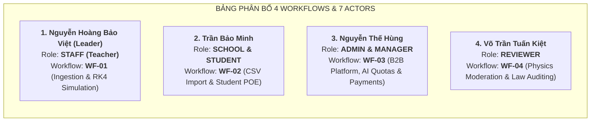

# KẾ HOẠCH HÀNH ĐỘNG & BẢN ĐỒ TÁC CHIẾN REVIEW 2 (05/11/2026)
> **Dự án:** PhysLive – Interactive Physics Simulation Platform for High School Teachers  
> **Mã đề tài:** FA26SE309 | **Lớp/Nhóm:** GFA26SE173 | **Kỳ bảo vệ:** Fall 2026  
> **Nhóm thực hiện (4 thành viên):**  
> 1. Nguyễn Hoàng Bảo Việt (`VietNHB` - SE183457) – Leader / Fullstack AI Lead / Role: `STAFF (Teacher)`  
> 2. Trần Bảo Minh (`MinhTB` - SE184103) – Backend Lead / Role: `SCHOOL` & `STUDENT`  
> 3. Nguyễn Thế Hùng (`HungNT` - SE183807) – BA & QA Lead / Role: `ADMIN` & `MANAGER`  
> 4. Võ Trần Tuấn Kiệt (`KietVTT` - SE182808) – Fullstack Lead / Role: `REVIEWER`  
> **Giảng viên hướng dẫn:** ThS. Nguyễn Tấn Phúc (`PhucNT@fe.edu.vn`)  
> **Workspace thực thi duy nhất:** `F:\Fcak\Code\PhysLive`  

---

## 1. MỤC TIÊU CỐT LÕI VÀ QUY ĐỊNH CỦA REVIEW 2
Căn cứ theo tài liệu chính thức của Nhà trường (`SWP490_R2_Huong-dan-chuan-bi-Review-2_1.pdf`):
1. **Chốt phiếu đăng ký phiên bản cuối:** Xác lập phạm vi đề tài bất di bất dịch trước giai đoạn phát triển chính.
2. **Góp ý chuyên môn về SRS và SDD:** Làm rõ tính nhất quán giữa yêu cầu, thiết kế và mã nguồn thực tế.
3. **Chốt yêu cầu sản phẩm bắt buộc & Mục tiêu Defense 1.1:**
   - 10 tính năng bắt buộc (FE-01 đến FE-10) với tiêu chí chấp nhận đo được.
   - 4 Main Workflows (mỗi thành viên sở hữu đúng 1 workflow trọn vẹn).
   - 8 Kịch bản Demo thực tế (mỗi workflow gồm 1 kịch bản chính và 1 kịch bản ngoại lệ).
   - Cam kết chỉ số kiểm thử: **50 Test Cases** (khớp 100% với `Report5_Test Report.xlsx`).
4. **Xác minh quyền sở hữu cá nhân (Vấn đáp cá nhân 1-1):** Giảng viên chọn ngẫu nhiên từng thành viên, yêu cầu mở trực tiếp code trong repository, giải thích cơ chế và xử lý tình huống giả định *"Nếu... thì sao?"*.

---

## 2. MA TRẬN PHÂN VAI & MAIN WORKFLOWS CHO 4 THÀNH VIÊN

| STT | Thành viên | Vai trò hệ thống | Phân hệ sở hữu | Main Workflow đăng ký | Kịch bản Demo |
| :---: | :--- | :--- | :--- | :--- | :--- |
| **1** | **Nguyễn Hoàng Bảo Việt** (`VietNHB`) | `STAFF` (Teacher) | WP1: Ingestion & Dual Solver Engine | **`WF-01`**: Teacher Simulation Authoring, RK4 Solving & Personal Library | DS-01a (Chính: Text/OCR sang RK4) & DS-01b (Ngoại lệ: Ambiguity Chips) |
| **2** | **Trần Bảo Minh** (`MinhTB`) | `SCHOOL` & `STUDENT` | WP2: Domain Core & Assessment | **`WF-02`**: School CSV Bulk Import, Class Roster & Student POE Assessment | DS-02a (Chính: CSV sang POE) & DS-02b (Ngoại lệ: CSV Syntax Error / Play Lock) |
| **3** | **Nguyễn Thế Hùng** (`HungNT`) | `ADMIN` & `MANAGER` | WP3: UI & WP4: B2B Governance | **`WF-03`**: B2B Platform Governance, Quota Allocation & VietQR Settlement | DS-03a (Chính: Onboarding & PayOS PAID) & DS-03b (Ngoại lệ: SUSPENDED_READ_ONLY) |
| **4** | **Võ Trần Tuấn Kiệt** (`KietVTT`) | `REVIEWER` | WP4: Security & Content Review | **`WF-04`**: Physics Content Moderation, Law Gap Auditing & Community Library | DS-04a (Chính: Review & Approve) & DS-04b (Ngoại lệ: Reject with Feedback) |

---

## 3. CHI TIẾT KỊCH BẢN DEMO & TRA CỨU CODE CHO TỪNG THÀNH VIÊN

### 3.1. NGUYỄN HOÀNG BẢO VIỆT (Phụ trách `STAFF / Teacher`)
- **Main Workflow `WF-01`:** Teacher Simulation Authoring & Numerical Solving
- **Đường đi trạng thái:** `Problem: DRAFT → PARSED → RK4_SOLVED → VERIFIED → SAVED_TO_LIBRARY`
- **Kịch bản Demo:**
  - *Kịch bản chính (DS-01a):* Giáo viên tải ảnh chụp bài toán con lắc lò xo → OCR trích xuất chữ tiếng Việt → Gán nhãn chủ đề GDPT 2018 → Chạy bộ giải RK4 bảo toàn cơ năng $|\Delta E/E_0| < 10^{-3}$ (`VERIFIED`) → Hiển thị mô phỏng 2D 60 FPS → Lưu vào Thư viện cá nhân.
  - *Kịch bản ngoại lệ (DS-01b):* Bài toán thiếu độ cứng $k$ → Hệ thống phát hiện mơ hồ, hiển thị chip làm rõ giả thiết (Ambiguity Chips) bắt giáo viên chọn giá trị trước khi kích hoạt bộ giải.
- **File Code mở ra khi hỏi:**
  - Frontend: `react-client/src/pages/Workspace.tsx`, `ProblemSubmitPage.tsx`, `CanvasPhysicsScene.tsx`.
  - Backend: `backend/.../ProblemIngestionService.java`, `SimulationSolverService.java`.
- **Câu hỏi "Nếu... thì sao?":** *"Nếu LLM sinh ra công thức phi vật lý làm năng lượng tự tăng dần thì sao?"*  
  -> **Trả lời:** `PhysicsLawValidator` phát hiện $|\Delta E / E_0| \ge 10^{-3}$, tự động gán nhãn `FLAGGED`, chặn xuất bản và kích hoạt vòng lặp AI Self-Repair kèm mã vi phạm để LLM sinh lại công thức đúng.

---

### 3.2. TRẦN BẢO MINH (Phụ trách `SCHOOL` & `STUDENT`)
- **Main Workflow `WF-02`:** School Administration & Student POE Assessment
- **Đường đi trạng thái:** `CSV: VALIDATED → COMMITTED | Assignment: ASSIGNED → PREDICTED → SUBMITTED → GRADED`
- **Kịch bản Demo:**
  - *Kịch bản chính (DS-02a):* School Admin tải file CSV danh sách 50 học sinh lên bảng preview → Xác nhận commit nguyên tử vào database → Giáo viên tạo bài tập POE → Học sinh đăng nhập, nộp dự đoán (Prediction) trước khi xem mô phỏng chạy → Xem kết quả tự động chấm điểm.
  - *Kịch bản ngoại lệ (DS-02b):* File CSV chứa email trùng lặp hoặc ngày sinh sai định dạng → Bảng preview tô đỏ dòng lỗi, cho phép sửa trực tiếp trên trình duyệt; Học sinh cố tình ấn Play xem mô phỏng trước khi gửi dự đoán → Hệ thống khóa nút Play đến khi submit Prediction.
- **File Code mở ra khi hỏi:**
  - Frontend: `SchoolBulkImport.tsx`, `SchoolClasses.tsx`, `StudentAssignments.tsx`.
  - Backend: `SchoolImportService.java`, `AssignmentService.java`, `AssignmentRandomizer.java`.
- **Câu hỏi "Nếu... thì sao?":** *"Nếu học sinh ngồi cạnh nhau mở cùng một bài tập thi thì làm sao chống chép bài?"*  
  -> **Trả lời:** Thuật toán `AssignmentRandomizer` băm tổ hợp `UUID(student_id) + UUID(assignment_id)` qua hàm PRNG tất định; mỗi học sinh nhận một bộ thông số vận tốc, góc nghiêng biến thiên $\pm 15\%$, đáp số khác nhau hoàn toàn nhưng thang điểm chuẩn hóa đồng nhất.

---

### 3.3. NGUYỄN THẾ HÙNG (Anh - Phụ trách `ADMIN` & `MANAGER`)
- **Main Workflow `WF-03`:** B2B Platform Governance, Quota Allocation & VietQR Settlement
- **Đường đi trạng thái:** `School: PENDING → ACTIVE → (SUSPENDED_READ_ONLY) | Payment: CREATED → PENDING → PAID / REQUIRES_REVIEW`
- **Kịch bản Demo:**
  - *Kịch bản chính (DS-03a):* Admin quản trị danh sách Manager; Manager duyệt trường THPT mới đăng ký gói Pro → Cấp hạn mức 500 học sinh & 500,000 Token AI → Đối soát giao dịch PayOS VietQR webhook thành công (`PAID`) → Giám sát tỷ lệ kiểm định vật lý toàn sàn (`/manager/validation`).
  - *Kịch bản ngoại lệ (DS-03b):* Trường học có tranh chấp hoặc vi phạm phí dịch vụ → Manager chuyển trạng thái sang `SUSPENDED_READ_ONLY` → Interceptor chặn mọi lệnh POST/PUT/DELETE (403 Forbidden) nhưng vẫn cho GET xem dữ liệu để bảo đảm quyền khiếu nại qua `/manager/feedback`.
- **File Code mở ra khi hỏi:**
  - Frontend: `AdminArea.tsx`, `AdminPayments.tsx`, `SchoolsView.tsx`, `CurriculumView.tsx`.
  - Backend: `AccountCapabilityInterceptor.java`, `PaymentAnalyticsService.java`, `AiUsageMeter.java`.
- **Câu hỏi "Nếu... thì sao?":** *"Tại sao Manager không tạo mô phỏng? Nếu trường học dùng hết hạn mức AI token trong tháng thì sao?"*  
  -> **Trả lời:** Manager là vai trò quản trị kinh doanh B2B; tạo mô phỏng thuộc quyền sư phạm của Giáo viên (`STAFF`). Khi trường hết token AI, `AiUsageMeter` ném lỗi `QuotaExceededException` chặn gọi AI, yêu cầu liên hệ Manager để nâng gói dịch vụ.

---

### 3.4. VÕ TRẦN TUẤN KIỆT (Phụ trách `REVIEWER`)
- **Main Workflow `WF-04`:** Physics Content Moderation, Law Gap Auditing & Community Library Publishing
- **Đường đi trạng thái:** `Simulation: PUBLIC_PENDING → (APPROVED | REJECTED_WITH_FEEDBACK) | LawGap: LOGGED (V51) → AUDITED`
- **Kịch bản Demo:**
  - *Kịch bản chính (DS-04a):* Reviewer vào bàn kiểm duyệt (`ReviewerConsole`) → Tiếp nhận mô phỏng do giáo viên chia sẻ công khai → Đối chiếu với danh mục định luật GDPT 2018 → Phê duyệt (`APPROVED`) để xuất bản lên Thư viện cộng đồng cho toàn quốc sử dụng.
  - *Kịch bản ngoại lệ (DS-04b):* Mô phỏng chưa gán mã chủ đề GDPT 2018 chuẩn hoặc bị phát hiện có sai lệch động học → Reviewer từ chối kèm phản hồi giải thích (`REJECTED_WITH_FEEDBACK`), hệ thống gửi thông báo trả về cho giáo viên chỉnh sửa.
- **File Code mở ra khi hỏi:**
  - Frontend: `ReviewerConsole.tsx`, `reviewerAccess.ts`.
  - Backend: `ReviewerModerationService.java`, `LawGapContracts.java`, migration `V51__law_gap_log_schema.sql`.
- **Câu hỏi "Nếu... thì sao?":** *"Tại sao không để Manager duyệt luôn mà phải sinh ra role Reviewer riêng?"*  
  -> **Trả lời:** Manager chỉ quản trị tài khoản và kinh doanh B2B; còn việc duyệt nội dung giảng dạy đòi hỏi chuyên môn sư phạm sâu sắc về chương trình vật lý phổ thông. Tách riêng role Reviewer giúp đảm bảo tính độc lập học thuật và an toàn nội dung trước khi đưa ra cộng đồng.

---

## 4. TỔNG HỢP TIẾN ĐỘ 4 BỘ HỒ SƠ REVIEW 2 (TRONG THƯ MỤC `Review2/`)

| STT | Tên Hồ sơ PDF theo Quy ước | Biểu mẫu gốc | Trạng thái hiện tại |
| :---: | :--- | :--- | :---: |
| **1** | `SWP490_FA26SE309_R2_Registration.pdf` | `FA26SE309_v2_leader.docx` + `BM03_Record_of_Changes.docx` | **ĐÃ HOÀN TẤT 100%** |
| **2** | `SWP490_FA26SE309_R2_Report1..5.pdf` | Report 1 đến Report 5 + `Report3_Project Tracking.xlsx` | **ĐÃ HOÀN TẤT 100%** |
| **3** | `SWP490_FA26SE309_R2_SelfReview.pdf` | `BM02_Self_Review_Report.docx` (7 findings, commit links) | **ĐÃ HOÀN TẤT 100%** |
| **4** | `SWP490_FA26SE309_R2_DesignBrief.pdf` | `BM01_Design_Brief.docx` (12 bảng, 4 workflows, 8 demos, 50 TCs) | **ĐÃ HOÀN TẤT 100%** |

*Biểu mẫu BM04 (Review 2 Commitment) sẽ được nhóm ký và nộp trong vòng 03 ngày làm việc sau buổi Review 2.*
