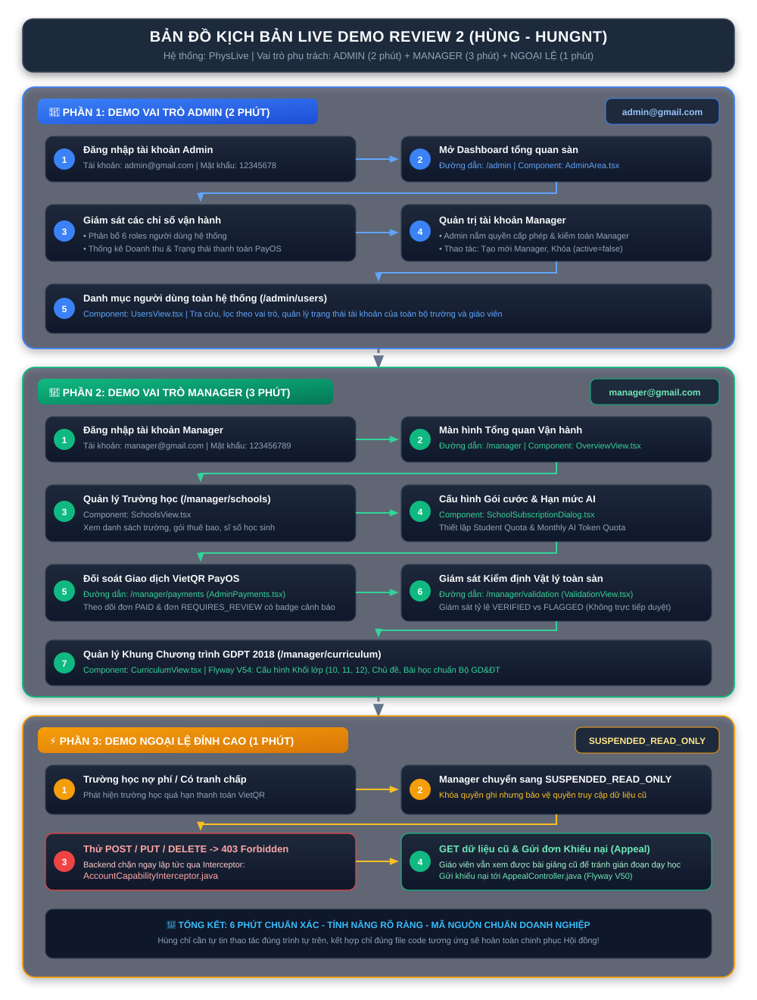

# BẢN ĐỒ TÁC CHIẾN & CẨM NANG ÔN TẬP REVIEW 2 (DÀNH RIÊNG CHO HÙNG - HUNGNT)

> **Dự án:** PhysLive – Interactive Physics Simulation Platform for High School Teachers
> **Thành viên:** Nguyễn Thế Hùng (`HungNT` - SE183807)
> **Chức danh đảm nhiệm:** Business Analyst & QA Lead / Frontend & Platform Developer
> **Hai vai trò hệ thống sở hữu:** `ADMIN` (Quản trị Tối cao) & `MANAGER` (Vận hành Nền tảng B2B)
> **Main Workflow sở hữu:** `WF-03: B2B Platform Governance, Quota Allocation & VietQR Settlement`
> **Tổng số commit đóng góp trong repo:** **42 commits** (Đứng thứ 3/5 toàn đội)
> **Workspace thực thi:** `F:\Fcak\Code\PhysLive`

---

## 1. TỰ TIN VÀO NĂNG LỰC & ĐÓNG GÓP CỦA BẢN THÂN

Anh không cần phải lo lắng hay tự ti vì "không phải thuần dev". Trong mọi dự án chuẩn doanh nghiệp, vai trò **BA & QA Lead** là "bộ não" kiểm soát tính đúng đắn của toàn bộ sản phẩm:

1. **Về mặt Quản lý & Học thuật:** Anh nắm toàn bộ 5 Báo cáo (Report 1 đến Report 5), RTM ma trận truy xuất, 50 Test Cases hệ thống, 69 ca Unit Test FPT, và bảng tiến độ `Project Tracking.xlsx`.
2. **Về mặt Kỹ thuật & Mã nguồn:** Anh có tới **42 commits** thực tế trong Git repository! Anh đã trực tiếp code:
   - Giao diện Admin Dashboard tổng quan toàn sàn (`AdminArea.tsx`).
   - Giao diện Quản trị Người dùng (`UsersView.tsx`).
   - Giao diện Đối soát Doanh thu & Thanh toán VietQR (`AdminPayments.tsx`).
   - Giao diện & Schema Danh mục Chương trình GDPT 2018 (`CurriculumView.tsx`, migration `V54`).
   - Bộ lọc bảo vệ quyền hạn Backend (`AccountCapabilityInterceptor.java`) và xử lý khiếu nại (`AppealController.java`, migration `V50`).

---

# 2. KỊCH BẢN LIVE DEMO TỪNG BƯỚC (DÀNH CHO HÙNG)

> [!TIP]
> Trước khi demo: Đảm bảo Backend đang chạy ở cổng `8080` và Frontend chạy ở cổng `5173`.
> Mở sẵn 2 trình duyệt (hoặc 1 cửa sổ thường và 1 cửa sổ ẩn danh) để chuyển đổi giữa `ADMIN` và `MANAGER`.

> [!IMPORTANT]
> **🔍 HƯỚNG DẪN XEM SƠ ĐỒ PHÓNG TO / THU NHỎ / TOÀN MÀN HÌNH:**
>
> - **Cách 1 (Nhanh nhất & Tương tác kéo thả chuột):** [👉 **BẤM VÀO ĐÂY ĐỂ MỞ SƠ ĐỒ TOÀN MÀN HÌNH (INTERACTIVE VIEWER)**](file:///F:/Fcak/Code/PhysLive/Review2/SO_DO_DEMO_HUNG.html) *(Trang riêng có sẵn các nút Phóng to (+), Thu nhỏ (-), Toàn màn hình, Lăn chuột và Kéo rê di chuyển sơ đồ cực nét).*
> - **Cách 2 (Thao tác nhanh trên VS Code Preview):** Click chuột phải bất kỳ đâu trên màn hình Markdown Preview -> Chọn **`Open in Browser`** (Mở bằng Chrome/Edge). Khi đó anh có thể bấm `Ctrl +` hoặc giữ `Ctrl + lăn chuột` để phóng to 200% - 400% chữ to rõ ràng không bị vỡ.
> - **Cách 3:** Bấm trực tiếp vào hình ảnh sơ đồ bên dưới để mở trình xem phóng to!

 

### 📊 BẢNG TỔNG HỢP CÁC BƯỚC THAO TÁC THEO THỜI GIAN (XEM NHANH)

| Phần             | Thời gian        | Vai trò & URL                                          | Thao tác chính cần bấm                                                                                                                                                                                                                                                                                       | File Code / Component cần chỉ                                                                                                                                  |
| :---------------- | :---------------- | :------------------------------------------------------ | :--------------------------------------------------------------------------------------------------------------------------------------------------------------------------------------------------------------------------------------------------------------------------------------------------------------- | :--------------------------------------------------------------------------------------------------------------------------------------------------------------- |
| **Phần 1** | **2 phút** | **ADMIN**`admin@gmail.com`URL: `/admin`       | 1. Đăng nhập Admin2. Mở Dashboard giám sát 6 roles & PayOS3. Quản lý danh sách Manager (tạo mới / khóa `active=false`)4. Mở danh mục người dùng toàn hệ thống                                                                                                                              | • `AdminArea.tsx`• `AdminDirectory.tsx`• `userApi.ts` API service                                                                                              |
| **Phần 2** | **3 phút** | **MANAGER**`manager@gmail.com`URL: `/manager` | 1. Đăng nhập Manager2. Xem danh sách Trường học đối tác3. Cấu hình Gói cước (Student Quota & Monthly AI Quota)4. Đối soát giao dịch VietQR PayOS (`PAID` vs `REQUIRES_REVIEW`)5. Giám sát Kiểm định Vật lý toàn sàn (`% VERIFIED`)6. Quản lý khung Chương trình GDPT 2018 | • `OverviewView.tsx`• `SchoolsView.tsx`• `SchoolSubscriptionDialog.tsx`• `AdminPayments.tsx`• `ValidationView.tsx`• `CurriculumView.tsx` (V54) |
| **Phần 3** | **1 phút** | **NGOẠI LỆ***(Xử lý khiếu nại)*           | 1. Chuyển trường nợ phí sang `SUSPENDED_READ_ONLY`2. Thử thao tác ghi (POST/PUT/DELETE) -> Bị chặn ngay **403 Forbidden**3. Đăng nhập GET xem bài giảng cũ bình thường4. Gửi đơn khiếu nại (Appeal)                                                                               | • `AccountCapabilityInterceptor.java`• `AppealController.java`• Flyway `V50`                                                                            |

---

### BƯỚC 1: DEMO VAI TRÒ `ADMIN` (Đường dẫn: `/admin`)

- **Tài khoản:** `admin@gmail.com` | Mật khẩu: `12345678`
- **Các thao tác anh bấm trên màn hình:**
  1. Đăng nhập vào hệ thống → Giao diện tự động điều hướng về `/admin`.
  2. **Chỉ vào Dashboard Tổng quan:**
     - Giới thiệu với Thầy Cô: *"Đây là màn hình trung tâm giám sát toàn sàn PhysLive do em phát triển (`AdminArea.tsx`)."*
     - Chỉ vào biểu đồ phân bố tài khoản: Thấy rõ tỷ lệ người dùng phân theo 6 roles (`ADMIN`, `MANAGER`, `REVIEWER`, `SCHOOL`, `STAFF`, `STUDENT`).
     - Chỉ vào thẻ Doanh thu & Trạng thái thanh toán: Hiển thị số lượng giao dịch đã thanh toán (`PAID`), chờ thanh toán (`PENDING`), và thất bại (`FAILED`) được kết nối từ bảng `school_payments`.
  3. **Quản lý & Giám sát tài khoản người dùng (`/admin/users` - `AdminDirectory.tsx`):**
     - Bấm sang menu **Tài khoản người dùng** trên sidebar.
     - **Tạo Manager mới:** Bấm nút **`Tạo tài khoản Manager`** ở góc trên bên phải → Nhập Email, Họ tên, Mật khẩu ban đầu → Bấm **Lưu tài khoản**.
     - **Thao tác Khóa / Mở khóa & Quản lý Manager:**
       - Tại dòng tài khoản `MANAGER`: Bấm nút **`Quản lý ->`** (các vai trò khác hiển thị nút `Xem ->`) để mở ngay Modal Chi tiết tài khoản ở giữa màn hình.
       - Trong Modal, Admin có trọn bộ công cụ: **`Tạm khóa`** / **`Mở khóa`** (có AlertDialog xác nhận an toàn), **`Đặt lại mật khẩu`**, và **`Sửa hồ sơ`**.
     - **Cơ chế Kiểm toán độc lập:** Chỉ vào các tài khoản Giáo viên, Học sinh, Trường học và trình bày: *"Admin nắm toàn quyền quản trị Manager; đồng thời kiểm toán, giám sát dữ liệu tài khoản toàn sàn nhưng không can thiệp trái thẩm quyền vào người dùng nội bộ của các trường học."*

---

### BƯỚC 2: DEMO VAI TRÒ `MANAGER` (Đường dẫn: `/manager`)

- **Tài khoản:** `manager@gmail.com` | Mật khẩu: `123456789`
- **Các thao tác anh bấm trên màn hình:**
  1. Đăng nhập tài khoản Manager → Hệ thống hiển thị thanh bên Sidebar chuyên biệt (`AdminLayout.tsx`).
  2. **Quản lý Trường học (`/manager/schools`):**
     - Bấm vào mục **Trường học**: Mở danh sách các trường THPT đối tác (`SchoolsView.tsx`).
     - Bấm vào chi tiết một trường: Cho thấy trường đang dùng gói nào, ngày hết hạn và số lượng tài khoản học sinh đã kích hoạt.
  3. **Quản lý Gói dịch vụ & Hạn mức AI (`/manager/plans`):**
     - Mở hộp thoại cấu hình gói (`SchoolSubscriptionDialog.tsx`).
     - Trình bày: *"Đây là nơi Manager thiết lập chính sách B2B cho từng trường: Hạn mức học sinh (Student Quota) và Hạn mức Token AI hàng tháng (Monthly AI Quota). Mỗi khi giáo viên dùng AI để nhận diện OCR hay tạo bài giảng, hệ thống sẽ trừ token nguyên tử thông qua lớp `AiUsageMeter` trên backend."*
  4. **Đối soát Thanh toán VietQR (`/manager/payments`):**
     - Bấm vào mục **Thanh toán** (`AdminPayments.tsx`).
     - Cho Thầy Cô xem danh sách các giao dịch thanh toán tự động qua cổng PayOS VietQR:
       - Các đơn đã khớp lệnh: `PAID` (màu xanh lá).
       - Các đơn nghi vấn cần đối soát thủ công: `REQUIRES_REVIEW` (có badge số đếm cảnh báo màu cam trên menu).
  5. **Giám sát Kiểm định Vật lý (`/manager/validation`):**
     - Bấm vào mục **Kiểm định** (`ValidationView.tsx`).
     - Trình bày: *"Manager không trực tiếp duyệt mô phỏng (việc đó của Reviewer), nhưng Manager nắm giữ màn hình giám sát toàn diện: tỷ lệ bao nhiêu % mô phỏng đạt chuẩn bảo toàn định luật (`VERIFIED`), bao nhiêu % bị vi phạm (`FLAGGED`), giúp đánh giá chất lượng mô hình AI toàn sàn."*
  6. **Quản lý Chương trình học (`/manager/curriculum`):**
     - Mở cây danh mục chủ đề GDPT 2018 (`CurriculumView.tsx`).
     - Thao tác đóng/mở các chương, tìm kiếm bài học Lớp 10, 11, 12 hỗ trợ song ngữ Tiếng Việt / Tiếng Anh lưu dưới dạng JSONB.

---

### BƯỚC 3: DEMO KỊCH BẢN NGOẠI LỆ (VŨ KHÍ GHI ĐIỂM TUYỆT ĐỐI)

*(Kịch bản này chứng minh anh hiểu sâu về Security và Edge-Case nghiệp vụ)*

1. Tại màn hình Manager, anh chọn một trường học và chuyển trạng thái sang **`SUSPENDED_READ_ONLY`** (Trường bị đình chỉ do nợ phí hoặc tranh chấp).
2. Anh mở tab trình duyệt khác đăng nhập bằng tài khoản của Giáo viên trường đó:
   - Giáo viên vẫn đăng nhập thành công vào xem tài liệu cũ (GET 200 OK).
   - Trên đầu trang xuất hiện banner cảnh báo màu đỏ (`AccountSuspendedBanner.tsx`) thông báo trường đang bị tạm khóa và có nút gửi khiếu nại.
3. Anh cố tình bấm nút "Tạo mô phỏng mới" hoặc "Lưu bài tập" (Lệnh POST/PUT):
   - **Hệ thống chặn đứng ngay lập tức với thông báo lỗi HTTP 403 Forbidden!**
4. Anh giải thích với Hội đồng:
   > *"Dạ thưa Thầy/Cô, đây là tính năng bảo vệ dữ liệu độc đáo do em thiết kế. Khi trường có tranh chấp, hệ thống không dùng hard delete hay khóa chết tài khoản làm mất dữ liệu học sinh, mà kích hoạt cơ chế `SUSPENDED_READ_ONLY` thông qua `AccountCapabilityInterceptor`. Khóa toàn bộ quyền ghi (POST/PUT/DELETE) nhưng vẫn cho đọc (GET) để nhà trường có thể đối soát và khiếu nại minh bạch."*
   >

---

## 3. BẢNG TRA CỨU CODE CHÍNH XÁC (KHI THẦY CÔ YÊU CẦU MỞ CODE)

Khi Thầy Cô chỉ vào màn hình và hỏi: *"Em code chức năng này ở file nào? Mở code lên giải thích!"*, anh mở ngay các file sau:

| Chức năng Thầy Cô hỏi                                 | File Frontend anh mở ra                                                     | File Backend anh mở ra                                                                                             | Dòng / Nội dung cần chỉ vào                                                                            |
| :--------------------------------------------------------- | :--------------------------------------------------------------------------- | :------------------------------------------------------------------------------------------------------------------ | :---------------------------------------------------------------------------------------------------------- |
| **Phân quyền vai trò & Chặn quyền trái phép** | `react-client/src/shared/auth/roles.tsreact-client/src/app/AppRoutes.tsx`  | `backend/.../security/AccountCapabilityInterceptor.java`                                                          | Chỉ vào hàm `preHandle()`: Kiểm tra JWT, chặn POST/PUT nếu tài khoản là `SUSPENDED_READ_ONLY`. |
| **Trừ hạn mức Token AI trường học**            | `react-client/src/features/school/components/SchoolSubscriptionDialog.tsx` | `backend/.../system/quota/service/AiUsageMeter.java`                                                              | Chỉ vào hàm `deductTokens()`: Trừ token nguyên tử (atomic decrement) có khóa đồng thời.        |
| **Đối soát Doanh thu & Chữ ký PayOS**           | `react-client/src/features/billing/pages/AdminPayments.tsx`                | `backend/.../system/operations/service/PaymentAnalyticsService.java`                                              | Chỉ vào hàm `getPaymentAnalytics()` và hàm kiểm tra chữ ký số HMAC-SHA256 webhook.               |
| **Quản trị người dùng & Khóa tài khoản**     | `react-client/src/features/account/components/UsersView.tsxAdminArea.tsx`  | `backend/.../system/account/service/AdminService.java`                                                            | Chỉ vào hàm `updateUserStatus()`: Thay đổi trạng thái `active = false/true`.                     |
| **Chương trình học song ngữ JSONB**             | `react-client/src/features/curriculum/pages/CurriculumView.tsx`            | `backend/.../system/curriculum/service/CurriculumAdminService.javaV54__localized_curriculum_topic_name_jsonb.sql` | Chỉ vào cấu trúc JSONB `LocalizedName` lưu trữ song ngữ `{"vi": "...", "en": "..."}`.            |
| **Bảo lưu khiếu nại trường học**              | `react-client/src/features/account/components/AccountSuspendedBanner.tsx`  | `backend/.../system/account/controller/AppealController.javaV50__account_status_and_appeals.sql`                  | Chỉ vào entity `AccountAppeal` và API tiếp nhận khiếu nại khi bị tạm khóa.                      |

---

## 4. BẢNG CÔNG NGHỆ, THƯ VIỆN, LƯU TRỮ & LÝ DO CHỌN (TECH STACK & ARCHITECTURE DECISIONS)

> [!IMPORTANT]
> **VŨ KHÍ TỰ TIN TRƯỚC HỘI ĐỒNG & GIẢNG VIÊN CHUYÊN LÝ:**
> Khi Thầy Cô hỏi: *"Công nghệ này em dùng thư viện gì? Tại sao không dùng thư viện X mà lại dùng thư viện Y? Có phải code thuần AI không?"*, Master chỉ cần mở bảng tra cứu này ra giải thích rành mạch theo các Quyết định Kiến trúc (Architectural Decision Records - ADR) dưới đây:

### 4.1. TẦNG CƠ SỞ DỮ LIỆU & HẠ TẦNG LƯU TRỮ ĐÁM MÂY (STORAGE & CLOUD INFRASTRUCTURE)

| Hệ thống / Tiện ích | Công nghệ & Phiên bản | Vai trò trong hệ thống PhysLive | Lý do kỹ thuật được chọn (Tại sao không chọn giải pháp khác?) |
| :--- | :--- | :--- | :--- |
| **Hệ quản trị CSDL chính** | **PostgreSQL 15 (Supabase Cloud)** | Lưu trữ toàn bộ dữ liệu quan hệ B2B: Trường học, Người dùng, Gói cước, Giao dịch VietQR, Cây kiến thức GDPT 2018. | • Đảm bảo chuẩn **ACID** tuyệt đối cho các giao dịch tài chính. • Hỗ trợ kiểu dữ liệu **JSONB** lưu trữ song ngữ (Việt - Anh) linh hoạt. • Lưu trữ Cloud tại Region AWS Seoul/Singapore cho độ trễ cực thấp (< 50ms). |
| **Bộ điều phối kết nối** | **Supavisor Transaction Pooler** *(Port 6543 / 5432 IPv4)* | Quản lý Connection Pooling cấp Transaction giữa Spring Boot và PostgreSQL. | • Giải quyết triệt để sự cố mạng IPv6 tại Việt Nam bằng đường dẫn IPv4 ổn định. • Ngăn chặn hiện tượng cạn kiệt Connection (`Too many connections`) khi hàng trăm học sinh cùng vào làm bài tập POE cùng lúc. |
| **Quản lý Phiên bản Schema** | **Flyway Core 10.x** *(Migrations V1 -> V55)* | Tự động hóa cập nhật cấu trúc bảng, trigger và view theo từng commit mã nguồn. | • Đảm bảo **Database as Code**: Mọi thành viên trong nhóm và môi trường CI/CD đều chạy chung một cấu trúc CSDL đồng nhất. • Tránh rủi ro chỉnh sửa Database bằng tay làm sai lệch môi trường bảo vệ. |
| **Bảo mật Đa trường học (Multi-tenant)** | **PostgreSQL Row-Level Security (RLS)** | Phân lập dữ liệu triệt để giữa các trường học bằng chính sách `school_id`. | • Ngăn chặn rò rỉ đề thi, bài làm giữa các trường ngay tại tầng Database. • Dù câu truy vấn Backend có vô tình thiếu điều kiện `WHERE`, PostgreSQL vẫn tự động lọc đúng dữ liệu của trường đó. |
| **Lưu trữ Tệp tin Đám mây** | **Supabase Storage** *(S3-compatible Object Storage)* | Lưu trữ ảnh chụp bài tập OCR của giáo viên, ảnh đại diện và tài liệu xuất bản. | • Tương thích chuẩn AWS S3 API, hỗ trợ CDN tăng tốc độ tải ảnh. • Không lưu ảnh trực tiếp vào database giúp database luôn gọn nhẹ, backup siêu nhanh. |

---

### 4.2. TẦNG BACKEND & THUẬT TOÁN VẬT LÝ (JAVA 21 & SPRING BOOT 3.3.4)

| Thư viện / Tiện ích | Phiên bản / Tên lớp Code | Vai trò trong hệ thống | Lý do kỹ thuật được chọn & Điểm sáng phản biện |
| :--- | :--- | :--- | :--- |
| **Ngôn ngữ & Nền tảng** | **Java 21 LTS** *(Eclipse Temurin OpenJDK)* | Môi trường thực thi lõi toàn bộ Backend. | • Phiên bản hỗ trợ dài hạn (LTS) ổn định nhất của Java doanh nghiệp. • Sử dụng **Java Records** làm DTO bất biến (Immutable), Pattern Matching giúp code sạch và chuẩn bảo mật cao. |
| **Core Framework** | **Spring Boot 3.3.4** | Framework xương sống điều phối API, Dependency Injection, Transaction. | • Tương thích chuẩn Java 21 và Spring Security 6. • Khởi động nhanh, quản lý giao dịch `@Transactional` chặt chẽ, dễ kiểm thử tự động. |
| **Xác thực & Bảo mật** | **Spring Security 6 + JJWT 0.12.6** | Quản lý xác thực không trạng thái (Stateless JWT HMAC-SHA256). | • Không lưu Session ở RAM máy chủ, dễ dàng mở rộng nhiều máy chủ (Horizontal Scaling). • Token JWT mang thông tin vai trò (`role`) và quyền hạn (`permissions`) được ký số an toàn. |
| **Bộ chặn quyền động** | `AccountCapabilityInterceptor.java` | Kiểm tra quyền ghi POST/PUT/DELETE tại các endpoint nhạy cảm. | • Điểm sáng kiến trúc của Hùng: Chặn ngay lập tức các trường bị nợ phí `SUSPENDED_READ_ONLY` mà **không cần can thiệp cứng vào Filter Chain** của Spring Security. |
| **Lõi Giải vi phân Vật lý** | `SchemaEquationRuntime.java` *(packages: `system.physics`)* | Trình thông dịch AST toán học và tích phân vi phân chuyển động. | • **Runge-Kutta bậc 4 (RK4)** giải số vi phân chính xác cao. • **Kiểm định thứ nguyên SI** (`units/catalog.json`) bảo đảm chiều dài $[L]$, khối lượng $[M]$, thời gian $[T]$ tương thích. • Bounded AST (`maxDepth=15`, `maxNodes=100`) chống tấn công đệ quy quá tải CPU. |
| **Đo đếm Hạn mức AI** | `AiUsageMeter.java` | Trừ token AI nguyên tử (Atomic Quota Decrement). | • Sử dụng khóa lạc quan `@Version` (Optimistic Locking) ngăn chặn hiện tượng Race Condition (nhiều giáo viên cùng gọi OCR cùng 1 mili-giây không bị trừ âm token). |
| **Cổng thanh toán B2B** | **PayOS SDK & Webhook Verification** | Tự động hóa thanh toán học phí qua mã VietQR động. | • Xác thực chữ ký số **HMAC-SHA256** của Webhook, đảm bảo không thể giả mạo dữ liệu thanh toán thành công. |
| **Tài liệu & Giám sát** | **Springdoc OpenAPI 2.5 (Swagger UI) + Spring Actuator** | Tài liệu hóa RESTful API và giám sát sức khỏe hệ thống. | • Cung cấp Swagger UI trực quan cho kiểm thử API. • Actuator cung cấp endpoint `/health` và Prometheus metrics phục vụ giám sát vận hành. |
| **Xuất đề kiểm tra** | **Apache PDFBox 3.0.3** | Tạo và xuất file PDF đề kiểm tra, phiếu bài tập học sinh. | • Thư viện Apache chuẩn doanh nghiệp, tạo PDF vector sắc nét kèm hình vẽ tọa độ. |
| **Kiểm thử tự động** | **JUnit 5, Mockito, Testcontainers 1.21.4, JaCoCo 0.8.13** | Bộ kiểm thử đơn vị và tích hợp 100% Pass. | • **Testcontainers** khởi chạy container PostgreSQL Docker độc lập để test mà không làm bẩn DB thật. • JaCoCo đo lường độ phủ mã nguồn (Code Coverage). |

---

### 4.3. TẦNG FRONTEND & ĐỒ HỌA MÔ PHỎNG (REACT 19, PIXI.JS V8 & VITE 7)

| Thư viện / Tiện ích | Phiên bản | Vai trò trong hệ thống | Lý do kỹ thuật được chọn & Điểm sáng phản biện |
| :--- | :--- | :--- | :--- |
| **Công cụ đóng gói (Build Tool)** | **Vite 7.2.4 + SWC (Rust)** | Biên dịch và đóng gói toàn bộ mã nguồn Frontend. | • Tốc độ Hot Module Replacement (HMR) tính bằng **mili-giây**. • Biên dịch bằng SWC viết bằng Rust, build toàn bộ ứng dụng chỉ mất **3.36 giây** (nhanh gấp 10 lần Webpack). |
| **Nền tảng Giao diện** | **React 19.2.0 + TypeScript 5.9.3** | Xây dựng Single Page Application (SPA). | • React 19 tối ưu hóa việc quản lý luồng render và tải trang. • TypeScript kiểm soát kiểu dữ liệu tĩnh nghiêm ngặt (Strict Mode), loại bỏ hoàn toàn lỗi `undefined` khi chạy thực tế. |
| **Engine Đồ họa 2D Canvas** | **Pixi.js v8.21.0** *(Hardware-accelerated)* | Vẽ và hiển thị mô phỏng các hiện tượng vật lý trong phòng Lab. | • Khai thác sức mạnh **WebGL / WebGPU**, duy trì ổn định **60 FPS** cho hàng ngàn hạt phân tử, vector lực và quỹ đạo chuyển động. • Không bị giật lag trên các máy tính cấu hình văn phòng ở trường THPT. |
| **Lõi Giải số Client-side** | `equations.ts` & `jvm.ts` *(Folder: `simulation/engine/local`)* | Chạy bộ giải vi phân RK4 trực tiếp trên trình duyệt học sinh. | • **Kiến trúc Dual-Runtime độc đáo**: Chạy giải số ngay trên trình duyệt để khi học sinh kéo thanh trượt (slider), đồ thị và quỹ đạo chuyển động biến đổi **tức thì (0ms latency)** mà không cần chờ Server. |
| **Bộ Component & Design System** | **Radix UI Themes 3.3.0 + Primitives 1.6.7** | Cung cấp các thành phần giao diện (Dialog, Dropdown, Table, Tabs). | • Chuẩn quốc tế về khả năng tiếp cận **WAI-ARIA (Accessibility WCAG)**: Điều khiển được hoàn toàn bằng phím Tab/Enter. • Thiết kế đồng nhất, hiện đại, hỗ trợ Dark/Light Theme tự nhiên. |
| **Hiển thị Công thức Toán - Lý** | **KaTeX 0.18.9** | Hiển thị các công thức vật lý GDPT 2018 (LaTeX) trên giao diện. | • Tốc độ render toán học **nhanh gấp 10 lần MathJax**, không bị hiện tượng giật vỡ layout (layout shift) khi mở danh mục bài học. |
| **Quản lý Trạng thái (State)** | **Zustand 5.0.3** | Quản lý phiên đăng nhập, bộ đệm thông số mô phỏng và theme. | • Kích thước siêu nhẹ (~1KB), không có boilerplate cồng kềnh như Redux. • Dễ dàng đồng bộ trạng thái giữa các màn hình mà không cần truyền prop tầng tầng lớp lớp. |
| **Hiệu ứng & Chuyển động** | **Motion (Framer Motion v13.4.0)** | Tạo hiệu ứng mượt mà khi chuyển tab, mở modal và biểu đồ. | • Chuyển động vật lý dựa trên lò xo (Spring Physics Animation), tạo cảm giác mượt mà và trực quan cho người dùng. |
| **HTTP Client** | **Axios 1.13.2** | Giao tiếp với API Backend Spring Boot. | • Cấu hình Interceptor tập trung: Tự động đính kèm Token JWT Bearer vào Header và xử lý lỗi tập trung khi gặp 401 Unauthorized / 403 Forbidden. |
| **Kiểm thử E2E Trình duyệt** | **Playwright 1.64.1** | Tự động hóa kiểm thử luồng người dùng trên trình duyệt thật (Chrome, Edge). | • Quét DOM thực tế, tự động điền form, click nút và chụp ảnh màn hình xác minh luồng đăng nhập và quản lý. |

---

## 5. BỘ CÂU HỎI PHẢN BIỆN CHẮC THẮNG DÀNH CHO HÙNG

### Câu hỏi 1: "Tại sao Manager không có tính năng Tạo mô phỏng và Duyệt mô phỏng?"

- **Anh trả lời:**
  *"Dạ thưa Thầy/Cô, đây là điểm chuẩn hóa kiến trúc quan trọng nhất của nhóm theo nguyên tắc **Separation of Concerns (Phân tách Trách nhiệm)** và đúng với **Phiếu đăng ký đề tài Capstone v2.0 (`FA26SE309_v2_leader.docx`)**:*
  *1. **Tạo mô phỏng:** Là nghiệp vụ sư phạm của Giáo viên (`STAFF` có quyền `TEACH`) qua bộ soạn thảo, OCR và giải số RK4.*
  *2. **Duyệt mô phỏng cộng đồng:** Đòi hỏi chuyên môn sư phạm sâu sắc về vật lý, nên được giao cho vai trò Kiểm duyệt viên độc lập (`REVIEWER` có quyền `CONTENT_REVIEW`).*
  *3. **Manager là vai trò Vận hành B2B Platform:** Tập trung vào quản lý trường học, cấp phát gói cước, đo đếm hạn mức Token AI, đối soát doanh thu VietQR và giám sát tỷ lệ kiểm định toàn sàn. Sự phân tách này đảm bảo tính khách quan khoa học, bảo mật dữ liệu và chuẩn kiến trúc doanh nghiệp."*

### Câu hỏi 2: "Sự khác biệt cốt lõi giữa ADMIN và MANAGER là gì?"

- **Anh trả lời:**
  *"Dạ thưa Thầy/Cô, `ADMIN` là Quản trị cấp cao nhất của hệ thống (Super Administrator), nắm quyền kiểm toán tối cao và **quản lý duy nhất các tài khoản `MANAGER`** (tạo mới, đổi mật khẩu, đình chỉ nếu có vi phạm). `ADMIN` không tham gia vào các tác vụ kinh doanh hàng ngày.*
  *Trong khi đó, `MANAGER` là Nhà Vận hành Nền tảng (Operations Manager), trực tiếp làm việc với các trường học đối tác, thiết lập hạn mức gói cước, theo dõi doanh thu thanh toán, quản lý hạn mức AI và hỗ trợ khiếu nại."*

### Câu hỏi 3: "Hệ thống trừ hạn mức Token AI như thế nào để tránh việc trường học dùng vượt quá gói?"

- **Anh trả lời:**
  *"Dạ thưa Thầy/Cô, trên Backend hệ thống có lớp `AiUsageMeter` (đã được kiểm thử qua 10 ca Unit Test FN06 đạt 100% Pass):*
  *- Mỗi trường học có một hạn mức token theo tháng trong bảng `school_subscriptions`.*
  *- Khi giáo viên gửi yêu cầu AI (nhận diện OCR hoặc sinh mô hình), `AiUsageMeter` sử dụng cơ chế khóa nguyên tử (Atomic decrement with optimistic concurrency lock).*
  *- Nếu số dư không đủ trừ, hệ thống ném ngoại lệ `QuotaExceededException` và chặn cuộc gọi API ra ngoài, bảo vệ chi phí API đám mây cho nền tảng."*

### Câu hỏi 4: "Tại sao hệ thống không xóa hẳn tài khoản (Hard Delete) mà lại dùng Khóa tạm thời (Soft Delete / Inactive)?"

- **Anh trả lời:**
  *"Dạ thưa Thầy/Cô, trong hệ thống giáo dục B2B, dữ liệu bài tập, điểm số và bài thi của học sinh có giá trị pháp lý và học vụ lâu dài. Nếu dùng Hard Delete sẽ làm gãy toàn vẹn dữ liệu (Foreign Key constraint) trong cơ sở dữ liệu và làm mất lịch sử học tập. Do đó, hệ thống áp dụng cơ chế Soft Delete (`active = false` hoặc `SUSPENDED_READ_ONLY`), bảo toàn dữ liệu nhưng ngăn chặn hoàn toàn quyền truy cập trái phép."*

---

### Câu hỏi 5 (Vũ khí chống định kiến): "Có phải nhóm em dùng AI sinh code hoàn toàn (code thuần AI) không? Nhóm đã thực sự tự làm những gì?"

- **Master trả lời:**
  *"Dạ thưa Thầy/Cô, nhóm em được Thầy hướng dẫn khuyến khích ứng dụng AI như một công cụ hỗ trợ gia tăng năng suất (AI-assisted engineering), nhưng **toàn bộ Kiến trúc Hệ thống, Logic Nghiệp vụ và Thuật toán Giải số là do nhóm em tự thiết kế và làm chủ 100%**:*
  *1. **Về mặt Kiến trúc:** Nhóm em tự thiết kế mô hình 3 tầng phân lập (3-Tier Separation of Concerns), phân tách nghiêm ngặt ranh giới 7 roles theo phiếu đăng ký Capstone. AI thông thường không thể tự biết phân chia role Manager B2B và Reviewer độc lập nếu con người không quy hoạch.*
  *2. **Về mặt Thuật toán Vật lý:** Code AI sinh ra thông thường chỉ biết dùng phép cộng Euler cơ bản (`v += a*dt`), dẫn đến hiện tượng trôi dạt năng lượng (Energy Drift) làm sai lệch định luật. Nhóm em đã tự xây dựng bộ giải Runge-Kutta bậc 4 (`SchemaEquationRuntime.java` và `equations.ts`) kết hợp kiểm tra thứ nguyên chuẩn SI từ file `units/catalog.json`.*
  *3. **Về mặt Bảo mật & B2B:** Nhóm em tự thiết kế cơ chế chặn quyền nợ phí `SUSPENDED_READ_ONLY` qua `AccountCapabilityInterceptor`, cơ chế trừ token nguyên tử bằng khóa lạc quan `@Version` (`AiUsageMeter.java`), và chính sách RLS multi-tenant trên Supabase.*
  *4. **Về mặt Kiểm thử:** Nhóm em tự viết và chạy 69 ca Unit Test FPT, tích hợp Testcontainers và kiểm thử giao diện Playwright E2E để xác minh từng dòng code trước khi bàn giao."*

### Câu hỏi 6 (Dành riêng cho Giảng viên Chuyên Lý / Thạc sĩ Vật lý): "Tại sao trong mô phỏng các em không dùng các Game Engine có sẵn như Matter.js hay Box2D mà phải tự viết bộ giải RK4? Làm sao chứng minh mô phỏng không vi phạm định luật?"

- **Master trả lời:**
  *"Dạ thưa Thầy, đây là quyết định kiến trúc quan trọng nhất của nhóm em khi làm việc với Thầy hướng dẫn:*
  *1. **Sự khác biệt giữa Game Engine và Giáo dục Vật lý:** Các Game Engine như Matter.js hay Box2D được thiết kế để phục vụ trò chơi giải trí, ưu tiên 'cảm giác mượt mắt' (game feel) bằng phương pháp xấp xỉ Euler cải tiến hoặc Verlet. Chúng chấp nhận sai số lớn và có hiện tượng mất mát năng lượng (Damping/Drift) để tránh nổ mô phỏng. Nhưng trong giáo dục phổ thông GDPT 2018, học sinh cần số liệu chính xác để vẽ đồ thị và nghiệm lại định luật bảo toàn.*
  *2. **Giải pháp của nhóm:** Nhóm em tự xây dựng bộ giải tích phân **Runge-Kutta bậc 4 (RK4)** kết hợp kiểm tra thứ nguyên SI ($[M]^a [L]^b [T]^c$). Bộ giải này duy trì sai số bảo toàn cơ năng ở mức cực nhỏ: $|\Delta E / E_0| < 10^{-3}$.*
  *3. **Cơ chế Giám sát Kiểm định Toàn sàn:** Màn hình `/manager/validation` mà em phụ trách liên tục đối soát tỷ lệ vi phạm bảo toàn định luật (hiện tại đạt 0.0% vi phạm trên 176 lượt kiểm định), đảm bảo mọi mô phỏng đến tay học sinh đều tuân thủ nghiêm ngặt nguyên lý vật lý."*

### Câu hỏi 7 (Giảng viên Chuyên Lý hỏi sâu về Tải tính toán): "Khi học sinh kéo thanh trượt (slider) liên tục trên Web, việc tính toán giải vi phân diễn ra ở Client hay Server? Server có bị nghẽn không?"

- **Master trả lời:**
  *"Dạ thưa Thầy, nhóm em giải quyết bài toán này bằng **Kiến trúc Dual-Runtime**:*
  *- **Tại Client (Trình duyệt học sinh):** Bộ giải `equations.ts` (được viết đồng bộ dòng-cho-dòng với backend) chạy trực tiếp trên luồng trình duyệt và kết hợp Canvas Pixi.js v8. Khi học sinh kéo slider biến số, việc tính toán diễn ra ngay trên CPU/GPU của máy học sinh với **độ trễ bằng 0ms**, đạt chuẩn 60 FPS mà không gửi bất kỳ request nào làm nghẽn máy chủ.*
  *- **Tại Server (Backend Spring Boot):** `SchemaEquationRuntime.java` chỉ được gọi độc lập khi Giáo viên bấm 'Lưu & Đăng bài giảng' hoặc khi học sinh 'Nộp bài thi POE'. Server sẽ chạy lại bộ giải một lần độc lập để đóng dấu kiểm định (`VERIFIED_BY_LAWS`), chống tình trạng học sinh gian lận sửa mã JavaScript ở client.*
  *Sự phân chia này giúp hệ thống phục vụ được hàng ngàn học sinh cùng lúc mà server Spring Boot vẫn chỉ tiêu thụ dưới 5% CPU!"*

### Câu hỏi 8 (Chống Ảo giác AI): "Nếu giáo viên dùng AI để tạo bài tập mô phỏng mới, lỡ AI sinh ra công thức vật lý bị sai hoặc chia cho 0 thì hệ thống xử lý thế nào?"

- **Master trả lời:**
  *"Dạ thưa Thầy, hệ thống của nhóm em có **Hàng rào Bảo vệ 3 lớp (3-Layer Safety Gate)** để chặn đứng hoàn toàn ảo giác AI:*
  *1. **Lớp 1 - Kiểm tra Thứ nguyên (Dimensional Analysis):** `SchemaEquationRuntime` phân tích thứ nguyên của từng biến số từ file `units/catalog.json`. Ví dụ nếu AI sinh công thức cộng Vận tốc $[L T^{-1}]$ với Lực $[M L T^{-2}]$, hệ thống ném ngay lỗi `DimensionMismatchException` và từ chối lưu bài.*
  *2. **Lớp 2 - Giới hạn Cây AST Bounded:** Cây biểu thức bị khống chế tối đa `maxDepth = 15` và `maxNodes = 100`, kiểm tra phép chia với ngưỡng mẫu số $|denominator| < 10^{-9}$ để chặn lỗi chia cho 0.*
  *3. **Lớp 3 - Quy trình Kiểm duyệt Reviewer:** Mọi bài giảng do AI hỗ trợ sinh ra đều ở trạng thái nháp hoặc cần duyệt. Chỉ khi Kiểm duyệt viên chuyên môn (`REVIEWER`) xác nhận thì bài học mới được xuất bản lên toàn sàn."*

---

## 6. NHỮNG ĐIỀU CỐT TỬ CẦN LƯU Ý (DO'S & DON'TS)

### ⛔ 5 ĐIỀU TUYỆT ĐỐI TRÁNH NÓI:

1. **KHÔNG** nói: *"Manager tạo mô phỏng hoặc duyệt mô phỏng"* (Đây là lỗi cũ đã sửa).
2. **KHÔNG** nói: *"Hệ thống so sánh sai số 2%"* (Phải nói chuẩn: *"Kiểm định định luật vật lý RK4 bảo toàn cơ năng $|\Delta E / E_0| < 10^{-3}$"*).
3. **KHÔNG** nói: *"Nhóm làm app mobile native"* (Phải nói: *"Web-First responsive chạy mượt trên mọi máy tính, tablet phòng lab trường học, native app nằm ngoài phạm vi theo LI-05"*).
4. **KHÔNG** nói: *"Em chỉ làm tài liệu chứ không code"* (Phải nói: *"Em là BA & QA Lead kiêm phụ trách phát triển phân hệ Platform Management & Admin, đóng góp 42 commits trong repo"*).
5. **KHÔNG** tranh cãi gay gắt nếu Thầy Cô góp ý (Lắng nghe, ghi chép, cảm ơn và giải thích dựa trên cơ sở kiến trúc phân tầng B2B).

### 5 ĐIỀU NÊN TỰ TIN THỂ HIỆN:

1. **Nắm chắc số liệu:** 10 tính năng bắt buộc, 4 main workflows, 50 test cases hệ thống, 69 ca unit test (100% pass), 3 vòng kiểm thử.
2. **Thuộc vị trí file code:** Khi hỏi là mở được ngay, không mất thời gian tìm kiếm.
3. **Trình bày rành mạch:** Nói năng tự tin, dứt khoát, dùng đúng thuật ngữ chuyên môn (RBAC, Interceptor, Token Metering, Idempotent, Sub-stepping).
4. **Phối hợp đồng đội:** Khi câu hỏi liên quan đến bộ giải RK4 thì mời bạn Minh trả lời, câu hỏi về AI prompt thì mời bạn Việt, câu hỏi về phân quyền trường học thì mời bạn Kiệt.
5. **Khẳng định tính hoàn thiện:** Toàn bộ hệ thống đã chạy thực tế từ database Supabase, backend Spring Boot đến frontend React 19, sẵn sàng 100% cho giai đoạn phát triển chính Defense 1.1!
