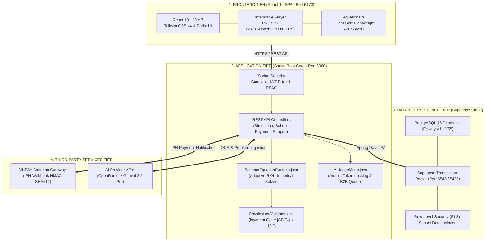
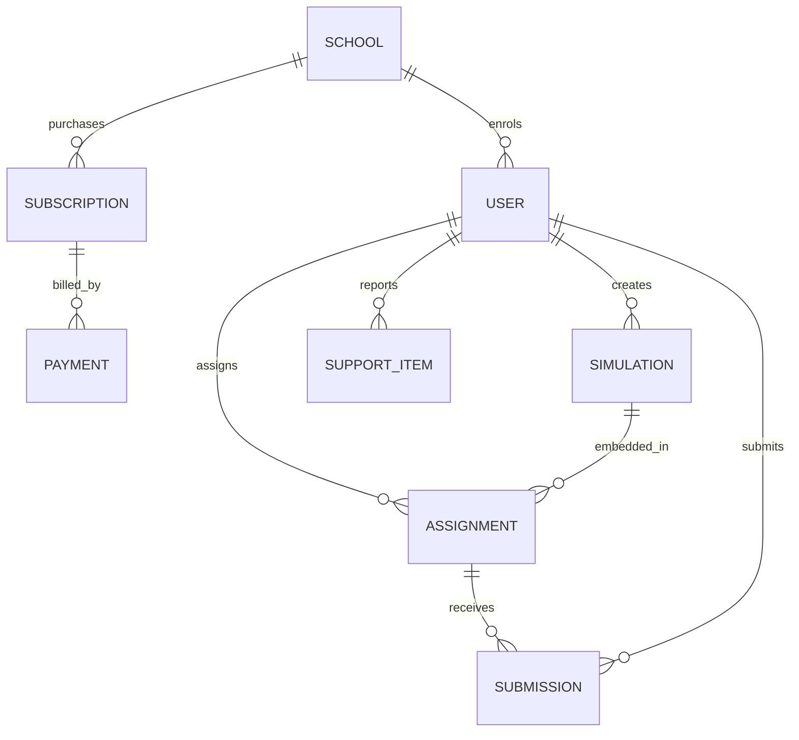
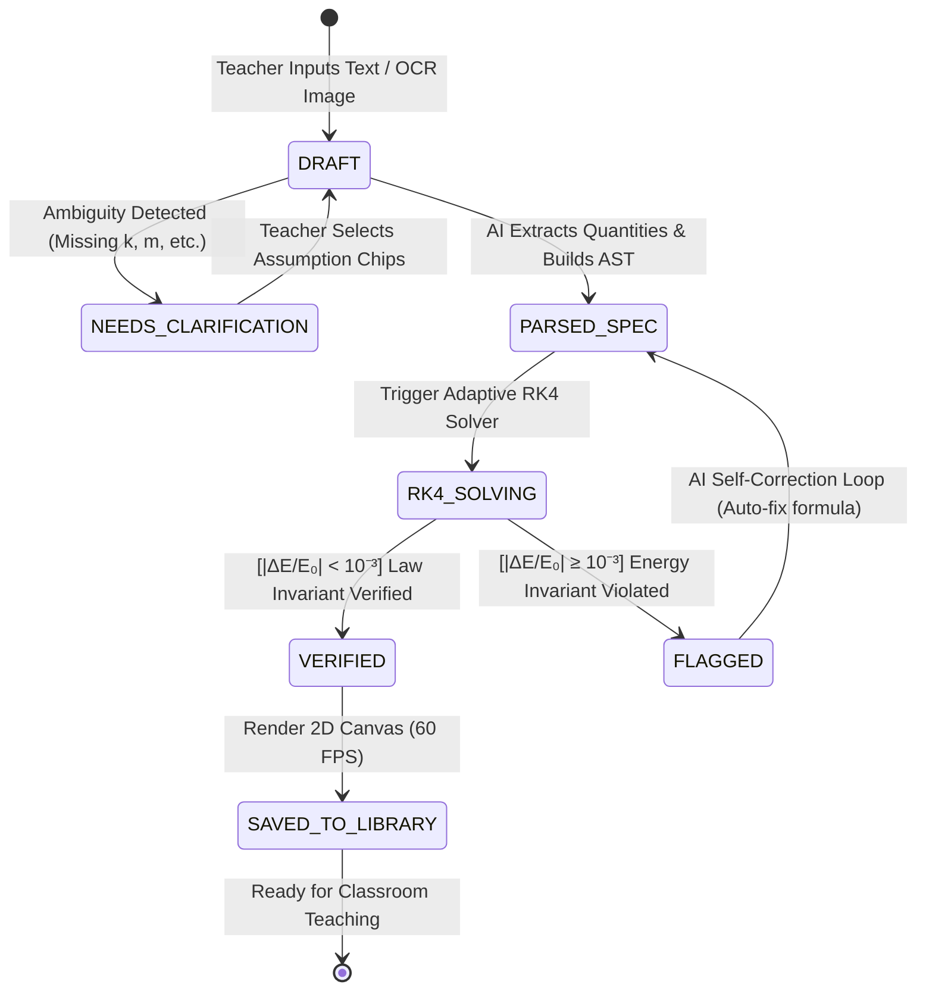
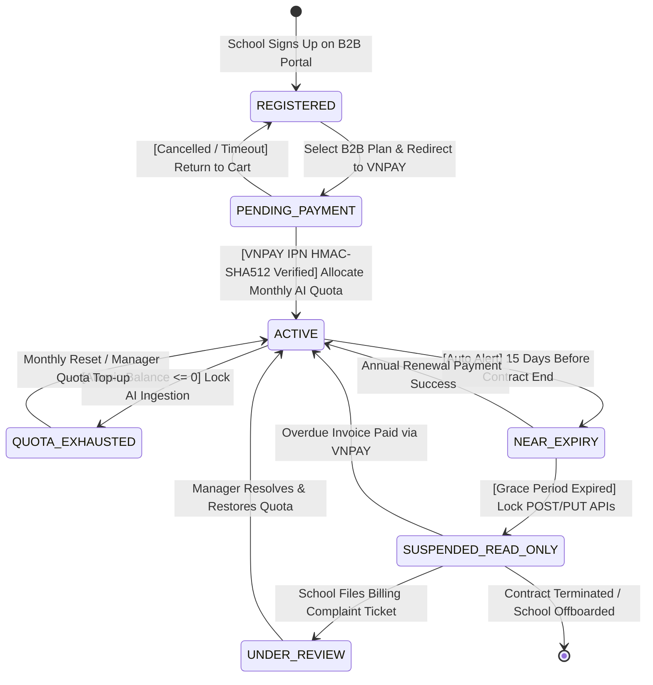
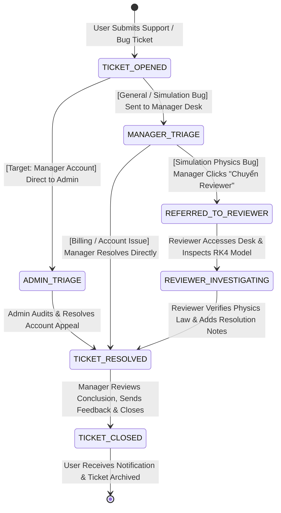
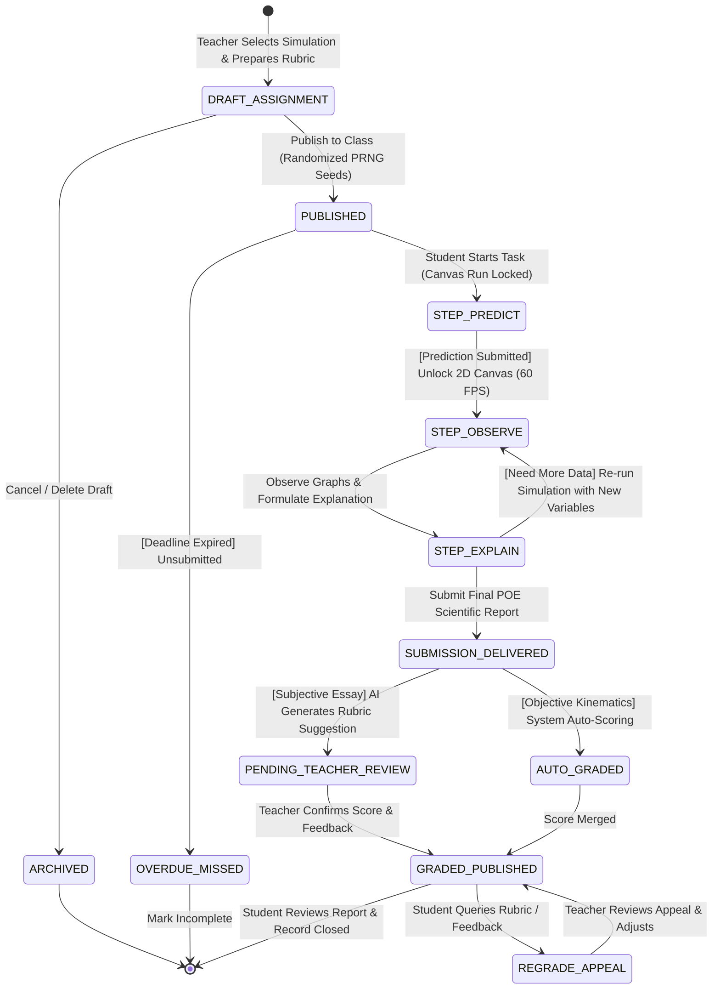

# TỔNG HỢP MÃ NGUỒN MERMAID CÁC SƠ ĐỒ CHO SLIDE (5, 9, 12, 13, 14, 15)
> **Dự án:** PhysLive – Nền tảng Mô phỏng Vật lý Tương tác (GDPT 2018)  
> **Hướng dẫn sử dụng Draw.io:**  
> 1. Mở [draw.io](https://app.diagrams.net/).  
> 2. Chọn menu: **Arrange** ➔ **Insert** ➔ **Advanced** ➔ **Mermaid**.  
> 3. Dán mã nguồn tương ứng bên dưới vào ➔ Nhấn **Insert**.  
> 4. Xuất ảnh: **File** ➔ **Export as** ➔ **PNG** (Chọn *Transparent Background*, 300 DPI) ➔ Dán đè vào slide PowerPoint.  

---

# 1. SLIDE 5: SƠ ĐỒ KIẾN TRÚC HỆ THỐNG ĐƠN GIẢN (SIMPLE ARCHITECTURE)
*(Tách biệt 4 tầng công nghệ theo đúng góp ý của Thầy Phúc: Frontend, Backend, Database/Storage, và Third-Party Services).*



---

# 2. SLIDE 9: SƠ ĐỒ ERD KHÁI NIỆM (CHỈ SHOW QUAN HỆ - HOÀN TOÀN KHÔNG CÓ THUỘC TÍNH)
*(Đúng chuẩn yêu cầu của Thầy Phúc và hình mẫu Master gửi: CHỈ hiển thị tên các Thực thể và đường nối Quan hệ, không sinh bảng thuộc tính chi tiết).*

### Cách 1: Mã Mermaid ERD Chuẩn (Không thuộc tính)


### Cách 2: Mã Mermaid Flowchart (Dạng các khối thẻ màu trực quan đẹp mắt trên Draw.io)
*(Nếu Master muốn hình hộp có icon màu sắc tương phản rõ nét để thuyết trình):*
```mermaid
flowchart TD
    classDef ent fill:#EFF6FF,stroke:#2563EB,stroke-width:2px,font-weight:bold,color:#1E3A8A;

    SCHOOL["🏫 SCHOOL"]:::ent
    USER["👤 USER"]:::ent
    SUBSCRIPTION["📋 SUBSCRIPTION"]:::ent
    PAYMENT["💳 PAYMENT"]:::ent
    SIMULATION["⚡ SIMULATION"]:::ent
    ASSIGNMENT["📝 ASSIGNMENT"]:::ent
    SUBMISSION["📤 SUBMISSION"]:::ent
    SUPPORT_ITEM["🛠️ SUPPORT_ITEM"]:::ent

    SCHOOL -->|1 : N (enrols)| USER
    SCHOOL -->|1 : N (purchases)| SUBSCRIPTION
    SUBSCRIPTION -->|1 : N (billed_by)| PAYMENT
    USER -->|1 : N (creates)| SIMULATION
    USER -->|1 : N (assigns)| ASSIGNMENT
    ASSIGNMENT -->|1 : N (receives)| SUBMISSION
    USER -->|1 : N (submits)| SUBMISSION
    SIMULATION -->|1 : N (embedded_in)| ASSIGNMENT
    USER -->|1 : N (reports)| SUPPORT_ITEM
```

---

# 3. SLIDE 12: CORE FLOW 1 (VIETNHB) - SIMULATION LIFECYCLE
*(Vòng đời mô phỏng: từ ảnh đề bài SGK ➔ trích xuất tham số ➔ kiểm định RK4 ➔ AI tự sửa lỗi ➔ xuất bản cộng đồng).*



---

# 4. SLIDE 13: CORE FLOW 2 (HUNGNT) - SUBSCRIPTION & QUOTA LIFECYCLE
*(Vòng đời thuê bao B2B, thanh toán VNPAY IPN, phân phối Quota Token AI nguyên tử và xử lý tranh chấp khiếu nại).*



---

# 5. SLIDE 14: CORE FLOW 3 (MINHTB) - MODERATION & COMPLAINT LIFECYCLE
*(Vòng đời duyệt bài cộng đồng & luồng tiếp nhận báo lỗi mô phỏng: Giáo viên báo lỗi ➔ Manager tiền trạm ➔ Reviewer thẩm định chuyên môn ➔ Hoàn tất).*



---

# 6. SLIDE 15: CORE FLOW 4 (KIETVTT) - ASSIGNMENT & STUDENT POE LIFECYCLE
*(Vòng đời giao bài và học sinh làm bài tập theo mô hình POE: Dự đoán ➔ Quan sát 60 FPS ➔ Giải thích ➔ Tự động chấm điểm).*


